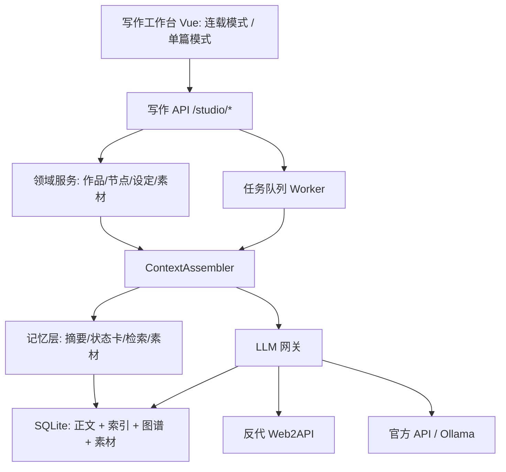

# Novel Studio 技术方案

> 在现有 Web2API 反代内核之上，构建一套「长篇连载 + 单篇文档」双形态的 AI 写作平台：
> 既支撑百万字级、多书并行的网文创作，也覆盖历史、时政、技术、生活推荐等单篇成稿场景。
> 本文档为实施方案，包含数据模型、模块划分、关键算法与分阶段路线。当前仅做设计，不含改动现有代码。
> 单篇类型的模板与检查规则细则见 `docs/content-types.md`。

## 0. 结论先行

| 决策项 | 结论 | 理由 |
|---|---|---|
| 底座 | 保留反代内核，写作业务作为上层新增 | 登录/风控/CDP 捕获是脏活，重写无收益 |
| LLM 出口 | 新增 `LLMClient` 网关，反代是其中一种实现 | 反代会因站点改版/封号失效，长篇是长期项目 |
| 上下文策略 | `history_mode=prompt` + 自建 `ContextAssembler` | 站点会话不可控、不可复现，长篇必须自己管上下文 |
| 记忆存储 | SQLite 单库多表，正文与索引解耦 | 现有栈已用 aiosqlite；索引可随时重建 |
| 检索 | 先 FTS5 + 图谱结构化，向量作为可选增强 | 写作检索 query 多为「人名/地名/事件」，关键词命中率高 |
| 向量方案 | fastembed + bge-small-zh-v1.5，512 维，按需加载 | 30MB 模型、常驻 250MB、单机 4 万块下暴力检索 <20ms |
| 图谱 | SQLite 存实体/关系/事件 + Python 侧 BFS 子图 | 单书几千节点，无需 Neo4j |
| 编排形态 | 后端确定性流水线，不做 Agent 自主决策 | 上游无 tools，每多一轮调用就多 3s 间隔 + 风控风险 |
| 并发 | 单 worker 串行队列 | 三家 provider 均 `max_concurrency: 1` |
| 内容形态 | 一套 `works + nodes` 树承载双形态，`kind` 决定启用哪些能力 | 避免两套 CRUD/编辑器/装配分支 |
| 单篇文档 | 模板 + 素材库 + 事实卡 + 术语表 四件套 | 单篇的核心不是连续性，而是准确与口径 |
| 落地顺序 | M1 先跑通「单篇文档」，再接长篇 | 单篇不依赖图谱，是最短验证路径 |

## 1. 目标与范围

### 1.1 业务目标

- 单机自用、无多用户体系，沿用现有 `W2A_API_KEY` 单口令
- **双形态**：
  - 长篇连载：多书并行（10 本以内），单本 100 万字以上，300-1000 章
  - 单篇文档：历史 / 时政 / 技术 / 生活推荐 / 报告等，单篇 2,000-20,000 字
- AI 全自动批量产出草稿，人工在编辑器内精修
- 长篇靠「长记忆 + 知识图谱」保证跨章一致；单篇靠「素材库 + 事实卡 + 术语表」保证准确与口径
- 零现金成本起步：生成通道以反代为主，后续可切官方 API / Ollama

### 1.2 不在本期范围

- 多人协作、权限体系、云端部署
- 版权/审核合规流程
- 图片生成、封面设计、有声书

### 1.3 规模基线（后续所有设计以此为准）

| 指标 | 取值 | 推算 |
|---|---|---|
| 单章字数 | 3,000-4,000 字 | 网文常规章节长度 |
| 单书总字数 | 100-300 万字 | 用户明确要求 |
| 单书章节数 | 300-1,000 章 | 300 万字 ÷ 3,000 字 |
| 同时在写书数 | ≤10 本 | — |
| 累计文本量 | ≤3,000 万字 | 10 × 300 万 |
| 分块大小 | 800 字，重叠 100 字 | 约 700 字有效步长 |
| 单书分块数 | 约 1,400-4,300 块 | 300 万字 ÷ 700 |
| 全库分块数 | 约 4.3 万块 | 3,000 万字 ÷ 700 |
| 单书实体数 | 200-800 个 | 人物/地点/物品/组织 |
| 单书关系数 | 1,000-5,000 条 | 实体数的 3-6 倍 |
| 单篇文档字数 | 2,000-20,000 字 | 技术长文/深度时评的上限 |
| 单篇文档节数 | 3-12 节 | 标题→小标题两级，极少到三级 |
| 系列型非虚构字数 | 30,000-200,000 字 | 课程讲义/行业报告/非虚构书 |
| 系列型节点数 | 8-60 个二级节点 | 20 讲课程约 20 讲、每讲 3-5 节 |
| 单篇素材量 | 5-50 条 | 每条 ≤ 20,000 字 |

### 1.4 内容类型与能力矩阵

`works.kind` 只有两个值：`novel`（连载）与 `article`（单篇）。两者的存储结构完全一致，差异只在**启用的能力模块**。

| 能力模块 | novel | article.single | article.series | 说明 |
|---|---|---|---|---|
| 节点树 | 卷→章→场景（3 层） | 标题→节（2 层） | 篇→讲→节（3 层） | 同一张 `nodes` 表，depth 不同 |
| 分层摘要 | 章/卷/全书 | 节/全文 | 节/讲/全书 | 同一套逻辑，粒度不同 |
| 知识图谱 | 启用 | 不启用 | 不启用 | 系列非虚构没有人物状态演化 |
| 时间线/伏笔 | 启用 | 不启用 | 不启用 | — |
| 交叉引用 | 可选 | 不启用 | 启用（「见第 3 讲」） | 系列特有 |
| 素材库 sources | 可选（考据） | 必用 | 必用 | 时政/历史/技术的事实来源 |
| 事实卡 facts | 不启用 | 启用 | 启用 | 带来源与有效期 |
| 术语表 terms | 可选 | 启用（技术类必用） | 必用 | 统一口径与写法 |
| 结构模板 templates | 卷纲模板 | 文体骨架 | 课程/报告骨架 | 决定大纲形态 |
| 一致性检查 | 5 条硬规则 + 2 条软规则 | 事实/术语/时效 + 2 条文档软规则 | 同左 + 交叉引用 | 见第 9 章（硬：error/warn 参与扣分；软：一律 info 不扣分） |
| 章纲 beats | 必做 | 可选（大纲即节纲） | 必做（每讲一张） | — |
| 字数上限 | 300 万字 | 2 万字 | 20 万字 | 由 `works.scale` 决定 |

**`works.scale` 不是第三种 kind**：`kind` 仍只有 `novel` / `article` 两个值，`scale` 是 article 的规模档位（`single` / `series`），只影响树深、摘要层级与交叉引用检查，不改变存储结构。改它不需要改表。

五种单篇类型的差异用「模板 + 检查规则」表达，**不新增代码分支**（系列型的完整模板见 `content-types.md` 4.6 节）：

| 类型 | 模板骨架 | 关键检查 | 特殊要求 |
|---|---|---|---|
| 历史 | 背景→事件→影响→史料辨析 | 年份/人名/地名核对、引文出处 | 素材必须带来源 |
| 时政 | 事实→多方立场→影响推演→结论 | 时效（`valid_until`）、口径、来源标注 | 需联网检索，注入「资料截止日期」 |
| 技术 | 背景→方案→步骤→坑→结论 | 术语一致、代码块完整、版本号 | 代码块不截断，术语表必用 |
| 生活推荐 | 场景→清单→对比→建议 | 广告法风险词、绝对化表述 | 口语化文风卡 |
| 通用单篇 | 引言→主体→结论 | 结构完整、字数达标 | 兜底模板 |

## 2. 现状评估

### 2.1 可直接复用的部分

| 模块 | 位置 | 复用方式 |
|---|---|---|
| 浏览器池与登录态 | `app/browser/playwright_pool.py`、`session_manager.py` | 原样复用 |
| 三家流式解析 | `app/providers/*.py` | 原样复用 |
| 统一增量事件 | `app/core/sse.py: DeltaEvent` | 原样复用 |
| 会话/消息存储 | `app/core/store.py` | 复用连接与模式，新增业务表 |
| 限流与并发控制 | `app/core/ratelimit.py: ProviderThrottle` | 原样复用 |
| 风控与人机验证 | `_browser_base.py`、`stream_capture.py` | 原样复用 |
| 前端脚手架 | Vue3 + Pinia + Tailwind | 新增视图，不改现有三页 |

### 2.2 关键约束（设计必须绕开的）

1. **无 function calling**：`openai_routes.py:_warn_headers` 对 `tools` 只回 `X-W2A-Warning`。所有"工具"必须由后端编排。
2. **`max_tokens` 是软截断**：本地丢字，上游仍在生成，浪费风控预算。写作要用提示词约束长度，而非依赖该参数。
3. **`temperature/top_p` 不透传**：无法调节创造性，只能靠 prompt 与多候选筛选。
4. **单 provider 并发 1、最小间隔 3s（千问）**：批量任务必须串行排队。
5. **站点会话切换有开销**：`open_conversation` + `apply_mode` 约 0.3-1.5s/次；prompt 模式下每轮都新开会话。
6. **prompt 模式无长度保护**：`_replay.py:render_prompt` 是全量拼接，长会话会无限增长。写作必须替换为预算受控的装配器。
7. **无 embedding 接口**：向量化必须另找来源。

### 2.3 一个必须正视的成本

按网页端 20-40 字/秒的输出速度，单章 3,000 字草稿需要 75-150 秒。单章完整流水线（草稿 + 自检 + 摘要 + 抽取）约 4-5 次上游调用，叠加 3s 间隔与会话切换，**单章约 4-8 分钟**。

- 100 章 ≈ 7-13 小时
- 750 章 ≈ 50-100 小时

这不是缺陷，是反代路线的物理上限。方案必须提供：断点续跑、暂停恢复、失败重试、只对定稿章做抽取（省一半调用）。

## 3. 总体架构



分层职责：

| 层 | 职责 | 不做什么 |
|---|---|---|
| API 层 | 参数校验、鉴权、SSE 透传 | 不拼 prompt |
| 能力矩阵 | 按 `kind` 决定启用哪些模块、桶、检查规则 | 不写业务逻辑 |
| 领域服务 | 作品/节点/设定卡/素材的 CRUD 与状态机 | 不调用 LLM |
| ContextAssembler | 按预算装配上下文、记录装配明细 | 不发请求 |
| 记忆层 | 摘要、状态卡、分块、检索、图谱查询 | 不改正文 |
| LLM 网关 | 统一调用接口、路由、降级、重试 | 不懂业务 |
| Worker | 任务调度、断点、风控暂停 | 不直接拼 prompt |

**核心原则：正文是唯一事实源，所有记忆都是可重建的派生索引。** 改稿后按 `index_state.dirty` 增量重建，任何索引损坏都能从正文恢复。

## 4. LLM 网关

### 4.1 接口

```python
class LLMClient(Protocol):
    async def stream(
        self,
        messages: list[dict],      # system/user 两条
        *,
        model: str,
        mode: str | None = None,
        thinking: bool = False,
        search: bool = False,
        max_chars: int | None = None,   # 软约束，用于提前终止
    ) -> AsyncIterator[str]: ...

    async def complete(self, messages, **kw) -> str: ...
```

### 4.2 三种实现

| 实现 | 用途 | 依赖 |
|---|---|---|
| `Web2APIClient` | 默认通道，包装现有 `Registry.route()` + `adapter.stream()` | 现有反代 |
| `OpenAICompatClient` | 官方 API / 第三方中转 | httpx |
| `OllamaClient` | 本地模型，零成本离线 | httpx + Ollama |

### 4.3 任务级路由（`config/llm-routing.yaml`）

```yaml
routes:
  outline:      {primary: "deepseek-chat",       fallbacks: ["qwen-max", "doubao-pro"]}
  draft:        {primary: "deepseek-chat",       fallbacks: ["doubao-pro", "qwen-max"]}
  polish:       {primary: "qwen-max",            fallbacks: ["deepseek-chat"]}
  summarize:    {primary: "doubao-lite",         fallbacks: ["qwen-turbo"]}   # 便宜模型够用
  extract:      {primary: "deepseek-chat",       fallbacks: ["doubao-lite"]}
  check:        {primary: "deepseek-chat",       fallbacks: ["qwen-plus"]}
```

降级规则：`W2AError` 中 `NeedsLogin` / `HumanVerifyRequired` 不降级（换 provider 也没用，直接暂停队列并告警）；其余错误按 fallbacks 顺序重试一次。

**M0 实测后的调整**：deepseek 在 28k 输入、140 字/秒、JSON 合法率 100%、素材零编造，可承担全部主力任务；qwen 当前命中固定拒绝卡片（风控态），doubao 12k 即触发滑块。原示例里「polish 用 qwen、summarize 用 doubao」的分工应改为**统一 deepseek 主、其余兜底**。

**为什么摘要/抽取用便宜模型**：这类任务输出结构化短文本，`doubao-lite` 足够；用主力模型会把单章成本从 4 次调用压到 2 次主力 + 2 次廉价。

## 5. 数据模型

单库 `storage/studio.sqlite`，与现有 `sessions.sqlite` 分离（避免业务写入干扰对话库）。启用 `WAL` 与外键。

### 5.1 作品与节点树

```sql
CREATE TABLE templates (
    id TEXT PRIMARY KEY,
    kind TEXT NOT NULL,               -- novel/article
    subtype TEXT DEFAULT '',          -- history/politics/tech/lifestyle/report
    name TEXT NOT NULL,
    outline_json TEXT NOT NULL,       -- [{heading, prompt, target_words}]
    style_prompt TEXT DEFAULT '',
    checks_json TEXT DEFAULT '[]',    -- 该模板启用的检查规则 id
    is_builtin INTEGER DEFAULT 0
);

CREATE TABLE works (
    id TEXT PRIMARY KEY,
    kind TEXT NOT NULL,               -- novel/article
    scale TEXT DEFAULT 'single',      -- article 专用：single/series
    subtype TEXT DEFAULT '',          -- 细分：history/politics/tech/lifestyle/report/course
    title TEXT NOT NULL,
    premise TEXT DEFAULT '',          -- 核心创意 / 一句话主旨
    status TEXT DEFAULT 'active',     -- active/paused/archived
    template_id TEXT REFERENCES templates(id) ON DELETE SET NULL,
    target_words INTEGER DEFAULT 0,   -- 目标字数，用于进度
    style_json TEXT DEFAULT '{}',     -- 人称/时态/文风/禁忌/口径
    meta_json TEXT DEFAULT '{}',
    created_at REAL NOT NULL,
    updated_at REAL NOT NULL
);

CREATE TABLE nodes (
    id TEXT PRIMARY KEY,
    work_id TEXT NOT NULL REFERENCES works(id) ON DELETE CASCADE,
    parent_id TEXT REFERENCES nodes(id) ON DELETE CASCADE,
    path TEXT NOT NULL,               -- 物化路径 '0001' / '0001.0003'
    depth INTEGER NOT NULL,           -- 0=卷/篇, 1=章/讲, 2=节, 3=子节
    ordinal INTEGER,                  -- 可读单元全序；容器节点为 NULL
    kind TEXT NOT NULL,               -- volume/chapter/section
    title TEXT NOT NULL,
    content TEXT DEFAULT '',          -- 正文（定稿版本）
    status TEXT DEFAULT 'draft',      -- draft/review/final
    word_count INTEGER DEFAULT 0,
    content_hash TEXT DEFAULT '',     -- 变更检测，决定是否重建索引
    summary TEXT DEFAULT '',          -- 节摘要缓存
    updated_at REAL NOT NULL
);
CREATE UNIQUE INDEX idx_nodes_path ON nodes(work_id, path);
CREATE INDEX idx_nodes_ordinal ON nodes(work_id, ordinal);

CREATE TABLE node_versions (
    id TEXT PRIMARY KEY,
    node_id TEXT NOT NULL REFERENCES nodes(id) ON DELETE CASCADE,
    version_no INTEGER NOT NULL,
    content TEXT NOT NULL,
    source TEXT NOT NULL,             -- ai_draft/ai_polish/human
    run_id TEXT,
    created_at REAL NOT NULL,
    UNIQUE(node_id, version_no)
);
```

**为什么用一棵树而不是两套表**：小说与文档的存储需求 90% 重合（标题、正文、状态、版本、摘要、字数），差异只在树的深度与启用模块。两套表意味着两套 CRUD、两套编辑器桥接、两套装配分支，维护成本翻倍。

**物化路径**：取某卷下所有章用 `WHERE path LIKE '0001.%'`，排序天然正确，无需递归 CTE。

| 形态 | depth 0 | depth 1 | depth 2 | depth 3 |
|---|---|---|---|---|
| novel | 卷（ordinal=NULL） | 章（ordinal=章序） | 场景（可选） | — |
| article.single | 根（可省） | 节（ordinal=节序） | 子节 | — |
| article.series | 篇（ordinal=NULL） | 讲/章（ordinal=全序） | 节 | 子节 |

`ordinal` 是所有「第 N 章／第 N 节」引用、索引重建、时间线排序的唯一依据。

### 5.2 设定卡与图谱

```sql
以下四类表只对 `kind=novel` 写入，单篇文档不启用。

```sql
-- 作者维护的「圣经」，权威事实
CREATE TABLE cards (
    id TEXT PRIMARY KEY,
    work_id TEXT NOT NULL REFERENCES works(id) ON DELETE CASCADE,
    kind TEXT NOT NULL,               -- character/location/item/faction/rule
    name TEXT NOT NULL,
    aliases TEXT DEFAULT '[]',        -- JSON 数组
    summary TEXT DEFAULT '',
    data_json TEXT DEFAULT '{}',      -- 结构化字段：年龄/境界/性格/禁忌...
    pinned INTEGER DEFAULT 0,         -- 1 = 每次装配必带
    updated_at REAL NOT NULL
);

-- 图谱节点（由卡与正文抽取共同产生）
CREATE TABLE entities (
    id TEXT PRIMARY KEY,
    work_id TEXT NOT NULL REFERENCES works(id) ON DELETE CASCADE,
    kind TEXT NOT NULL,
    name TEXT NOT NULL,
    canonical TEXT NOT NULL,          -- 规范化名，用于对齐
    aliases TEXT DEFAULT '[]',
    card_id TEXT REFERENCES cards(id) ON DELETE SET NULL,
    first_ordinal INTEGER DEFAULT 0,
    status TEXT DEFAULT 'alive',      -- alive/dead/destroyed/missing
    status_ordinal INTEGER DEFAULT 0,
    UNIQUE(work_id, canonical)
);

CREATE TABLE relations (
    id TEXT PRIMARY KEY,
    work_id TEXT NOT NULL REFERENCES works(id) ON DELETE CASCADE,
    src_id TEXT NOT NULL REFERENCES entities(id) ON DELETE CASCADE,
    dst_id TEXT NOT NULL REFERENCES entities(id) ON DELETE CASCADE,
    rel_type TEXT NOT NULL,           -- 师徒/亲属/敌对/隶属/持有/位于/参与/因果
    since_ordinal INTEGER DEFAULT 0,
    until_ordinal INTEGER,            -- NULL = 仍有效
    confidence REAL DEFAULT 1.0,
    evidence_ordinal INTEGER,
    UNIQUE(src_id, rel_type, dst_id, since_ordinal)
);
CREATE INDEX idx_rel_src ON relations(work_id, src_id);
CREATE INDEX idx_rel_dst ON relations(work_id, dst_id);

-- 时间线事件
CREATE TABLE events (
    id TEXT PRIMARY KEY,
    work_id TEXT NOT NULL REFERENCES works(id) ON DELETE CASCADE,
    ordinal INTEGER NOT NULL,
    seq_in_unit INTEGER DEFAULT 0,
    summary TEXT NOT NULL,
    participants TEXT DEFAULT '[]',   -- JSON 实体 id 数组
    location_id TEXT,
    story_time TEXT DEFAULT '',       -- 故事内时间，规范化字符串
    importance INTEGER DEFAULT 1      -- 1-5，决定是否入选上下文
);
CREATE INDEX idx_events_work ON events(work_id, ordinal, seq_in_unit);

-- 实体状态快照（只在状态变化时写一条）
CREATE TABLE entity_states (
    id TEXT PRIMARY KEY,
    work_id TEXT NOT NULL REFERENCES works(id) ON DELETE CASCADE,
    entity_id TEXT NOT NULL REFERENCES entities(id) ON DELETE CASCADE,
    ordinal INTEGER NOT NULL,
    state_json TEXT NOT NULL,         -- 境界/位置/伤势/持有物/目标/已知秘密
    UNIQUE(entity_id, ordinal)
);

CREATE TABLE foreshadows (
    id TEXT PRIMARY KEY,
    work_id TEXT NOT NULL REFERENCES works(id) ON DELETE CASCADE,
    planted_ordinal INTEGER NOT NULL,
    planned_payoff_ordinal INTEGER,
    resolved_ordinal INTEGER,
    content TEXT NOT NULL,
    status TEXT DEFAULT 'open',       -- open/resolved/abandoned
    importance INTEGER DEFAULT 1
);
```

**单篇文档的替代四件套**（替代图谱承担「准确与口径」职责）：

```sql
-- 素材库：粘贴的参考资料、笔记、链接
CREATE TABLE sources (
    id TEXT PRIMARY KEY,
    work_id TEXT NOT NULL REFERENCES works(id) ON DELETE CASCADE,
    kind TEXT DEFAULT 'note',         -- note/web/clip/file
    title TEXT DEFAULT '',
    url TEXT DEFAULT '',
    content TEXT NOT NULL,
    published_at TEXT DEFAULT '',     -- 资料本身的日期，用于时效判断
    fetched_at REAL,
    used INTEGER DEFAULT 0            -- 是否已被正文引用
);

-- 事实卡：从素材抽取的可引用事实，带来源与有效期
CREATE TABLE facts (
    id TEXT PRIMARY KEY,
    work_id TEXT NOT NULL REFERENCES works(id) ON DELETE CASCADE,
    statement TEXT NOT NULL,
    source_id TEXT REFERENCES sources(id) ON DELETE SET NULL,
    confidence REAL DEFAULT 1.0,
    valid_until TEXT DEFAULT '',      -- 时效：时政/价格/版本号会过期
    cited_node_id TEXT,               -- 被哪一节引用
    created_at REAL
);

-- 术语表：统一口径与写法（技术类必用）
CREATE TABLE terms (
    id TEXT PRIMARY KEY,
    work_id TEXT NOT NULL REFERENCES works(id) ON DELETE CASCADE,
    term TEXT NOT NULL,
    definition TEXT DEFAULT '',
    preferred TEXT DEFAULT '',        -- 偏好写法
    forbidden TEXT DEFAULT '[]',      -- 禁用说法 JSON 数组
    UNIQUE(work_id, term)
);

-- 检查结果（两种形态共用）
CREATE TABLE issues (
    id TEXT PRIMARY KEY,
    work_id TEXT NOT NULL REFERENCES works(id) ON DELETE CASCADE,
    node_id TEXT REFERENCES nodes(id) ON DELETE CASCADE,
    rule TEXT NOT NULL,               -- dead_character/fact_stale/term_inconsistent...
    severity TEXT DEFAULT 'warn',     -- info/warn/error
    message TEXT NOT NULL,
    evidence TEXT DEFAULT '',
    location TEXT DEFAULT '',         -- 段落偏移，供前端定位
    resolved INTEGER DEFAULT 0,
    created_at REAL
);
```

### 5.3 索引与摘要

```sql
CREATE TABLE chunks (
    id TEXT PRIMARY KEY,
    work_id TEXT NOT NULL REFERENCES works(id) ON DELETE CASCADE,
    source_kind TEXT NOT NULL DEFAULT 'body',   -- body=正文 / source=素材
    node_id TEXT REFERENCES nodes(id) ON DELETE CASCADE,
    source_id TEXT REFERENCES sources(id) ON DELETE CASCADE,
    ordinal INTEGER DEFAULT 0,        -- 在 work 内的位置序
    seq_in_unit INTEGER DEFAULT 0,
    text TEXT NOT NULL,
    text_tok TEXT NOT NULL,           -- jieba 分词后空格连接，供 FTS5 用
    char_start INTEGER DEFAULT 0,
    char_end INTEGER DEFAULT 0
);
CREATE INDEX idx_chunks_work ON chunks(work_id, source_kind, ordinal);

CREATE VIRTUAL TABLE chunks_fts USING fts5(
    text_tok, content='chunks', content_rowid='rowid', tokenize='unicode61'
);

CREATE TABLE chunk_vectors (
    chunk_id TEXT PRIMARY KEY REFERENCES chunks(id) ON DELETE CASCADE,
    model TEXT NOT NULL,
    dim INTEGER NOT NULL,
    vec BLOB NOT NULL                 -- float32 小端序，dim*4 字节
);                                      -- ↑ 仅设计草案，**尚未建表**（见 15.3 的更正）

CREATE TABLE summaries (
    id TEXT PRIMARY KEY,
    work_id TEXT NOT NULL REFERENCES works(id) ON DELETE CASCADE,
    scope TEXT NOT NULL,              -- node/volume/work（单篇只用到 node/work）
    ref_id TEXT NOT NULL,             -- node_id / volume node_id / work_id
    ref_ordinal INTEGER DEFAULT 0,
    ref_hash TEXT DEFAULT '',         -- v2.0 补：生成时的内容指纹，'' = 已知过期
    content TEXT NOT NULL,
    model TEXT DEFAULT '',
    created_at REAL NOT NULL,
    UNIQUE(scope, ref_id)
);

CREATE TABLE index_state (
    work_id TEXT PRIMARY KEY REFERENCES works(id) ON DELETE CASCADE,
    last_chunk_ordinal INTEGER DEFAULT 0,
    last_graph_ordinal INTEGER DEFAULT 0,
    last_summary_ordinal INTEGER DEFAULT 0,
    dirty INTEGER DEFAULT 0,
    updated_at REAL NOT NULL
);
```

> **`ref_hash` 是 v2.0 补的列**，旧库靠 `store._migrate()` 走 `ALTER TABLE`（`CREATE TABLE IF NOT EXISTS` 不会给已存在的表加列）。
> 升级当天不能把所有记忆一夜判过期，所以历史行要回填：`scope='node'` 回填该节点的 `content_hash`（空正文用 `NULLIF` 跳过），
> `container`/`work` 回填 `'legacy'`。**口径只有一条：指纹按未 strip 的原文算**（`_hash(node["content"] or "")`，
> 与 `store.update_node` 里维护的 `nodes.content_hash` 同一口径）。按 strip 后的文本算会让每次保存都判过期，
> 等于每次白烧一次模型——这一条已有回归测着（正文只加尾部空格不判过期）。
> 容器/全书摘要是多节拼出来的，没有单一源文本：生成时写 `_hash(拼接后的子摘要)`，子节改动时由失效传播置成 `''`。

### 5.4 运行记录与任务队列

```sql
CREATE TABLE runs (
    id TEXT PRIMARY KEY,
    work_id TEXT NOT NULL,
    node_id TEXT,
    task_type TEXT NOT NULL,
    model TEXT DEFAULT '',
    provider TEXT DEFAULT '',
    prompt_chars INTEGER DEFAULT 0,
    output_chars INTEGER DEFAULT 0,
    prompt_hash TEXT DEFAULT '',
    variant INTEGER DEFAULT 0,        -- 多候选择时的序号（0=首个）
    score REAL,                       -- 自动质量评分 0-100
    status TEXT DEFAULT 'running',    -- running/ok/failed/interrupted
    error TEXT DEFAULT '',
    elapsed_ms INTEGER DEFAULT 0,
    started_at REAL NOT NULL,
    finished_at REAL
);

CREATE TABLE jobs (
    id TEXT PRIMARY KEY,
    work_id TEXT NOT NULL,
    node_id TEXT,
    task_type TEXT NOT NULL,
    payload_json TEXT DEFAULT '{}',
    status TEXT DEFAULT 'queued',     -- queued/running/done/failed/cancelled
    priority INTEGER DEFAULT 5,
    attempts INTEGER DEFAULT 0,
    max_attempts INTEGER DEFAULT 2,
    idem_key TEXT UNIQUE,             -- 存「业务键#毫秒」，只做追溯，不参与判重
    last_error TEXT DEFAULT '',
    scheduled_at REAL,
    created_at REAL NOT NULL,
    updated_at REAL NOT NULL
);
CREATE INDEX idx_jobs_status ON jobs(status, priority DESC, created_at);
```

> 三处实现细节（都踩过坑）：
>
> 1. **幂等判重不看 `idem_key` 列**。该列有 UNIQUE 约束，历史 `done` 记录把键占住后再入队会直接报 `UNIQUE constraint failed`（实测踩过 500）。真正的判重条件是「`work_id + node_id + task_type` 且状态仍为 `queued/running`」，命中直接返回已有 job 并标 `deduped`；`idem_key` 只存「业务键#毫秒」用于追溯。
> 2. **`jobs` / `runs` / `index_units` / `chunks_fts` 都不受外键保护**。前三张建得早，`work_id` 上没写 `REFERENCES works(id)`；`chunks_fts` 是 FTS5 虚拟表，外键根本管不到它。所以 `delete_work()` 里四张都要手动清（`store._NO_FK_TABLES` + 一条 `DELETE FROM chunks_fts WHERE work_id = ?`）。
>    漏掉的后果分别是什么：`jobs` 留着 → 队列领到旧任务，连续报「作品不存在」；`runs` 留着 → 成本与质量统计里混入不存在作品的分数；`index_units` 留着 → 重建时误判「内容没变，跳过索引」；`chunks_fts` 留着 → 倒排索引虚胖（搜索仍是对的，因为第二步会 join 回 `chunks`，孤儿块查不到内容）。
>
>    同一个坑在**删单节 / 删素材**时更隐蔽：作品还活着，按 `work_id` 清是清不到的。所以 `delete_node()` / `delete_source()` 都改成先调 `store._drop_unit_rows(ref_kind, ids)`（按子树 id 清 `chunks_fts` + `index_units`，节点还多清一份 `summaries`），再删节点/素材。顺序有讲究：`chunks` 被级联带走之后，就再也查不到对应的 `chunk_id` 了。
>
> 3. **这条是清书架时顺带查出来的**：`store.orphan_counts()` 按 `_ORPHAN_WHERE` 逐表统计孤儿行——`jobs`/`runs`/`index_units`/`chunks_fts` 按 `work_id`（以及 `chunks_fts` 按 `chunk_id`）判，`index_units`/`summaries` 还要按「指向的节点/素材还在不在」判，就是为了兜住上面那条隐蔽路径。修 `delete_work` 之前一次清理留下了 `runs` 54 / `index_units` 58 / `chunks_fts` 63 条孤儿。既有残留由 `store.sweep_orphans()` 兜底（入口：`python -m scripts.cleanup_works --sweep-orphans`）。回归测试见 `tests/test_store_delete.py`。

### 5.5 正文与索引的解耦约定

1. `nodes.content_hash` 变化 → 该节点分块/摘要/图谱标记失效。**v2.0 才真正接上「摘要」这一路**：原先 `summaries` 只比 `ref_ordinal`，
   重写第 7 章后拿回的仍是上一版摘要——记忆不是旧了，是假的。现在 `update_node` 在正文实际变化时（改标题/状态不算）
   于同一事务内调 `store._mark_stale_locked()`，把该节点父链上的 container 摘要与全书摘要的 `ref_hash` 置空；
   节摘要不显式标，它的 `ref_hash` 与新 `content_hash` 自然对不上。读取侧 `get_summary`/`list_summaries` 带 `fresh` 布尔，
   assembler 的 S3/S4 与 `tasks._prev_summary` 只取新鲜的，被跳过的数量写进 `warnings`（右栏「上下文」页直接看得到）。
   失效只置标记不重算：重算是模型调用，得人点「重算过期摘要」或后处理链路才会发生
2. `index_state.dirty = 1` → 后台 worker 增量重建，不阻塞写作
3. 重建顺序：分块 → 摘要 → 图谱抽取（前者失败不阻塞后者）
4. 删节点 → 级联删 chunks/summaries（`vectors` 尚未建表，见 15.3）；`events`/`relations` 按 `ordinal` 清理，实体保留（可能在其他章出现）。**已修**：原先 `delete_node()` 只删节点，`chunks` 靠 `node_id` 级联掉了，但 `chunks_fts` 里的行留着（同一个坑的另一条路径，见 5.4），`index_units` 台账与节点摘要同样没人清。现在删节点前会按整棵子树的 id 把这三类一起清掉——摘要这一条不只是虚胖：S4「最近节摘要」按 `work_id` 全量取，不删的话已删章节会以摘要的形式继续回到每次生成的上下文里。删素材同理（`delete_source()` 清 `chunks_fts` + `index_units`）。历史上的残留用 `--sweep-orphans` 清
5. 单篇文档无图谱，`last_graph_ordinal` 恒为 0；素材变更只重建 `source_kind='source'` 的块

### 5.6 内容类型的配置化

内容类型不能写死在代码里——「五类只是举例」，那新增一类就不该改 Python。**已落地为根目录 `content-types.yaml` + `app/studio/content_types.py`。**

三层合并：`kinds.<kind>` 默认 → `scales.<scale>` → `subtypes.<subtype>`。标量后者覆盖前者；`xxx_append` 追加到 `xxx` 并去重。

```yaml
kinds:
  article:
    label: 文档
    budget_chars: 18000
    buckets: [S0, S1, S2, S_src, S7, S8]
    style_prompt: 用书面中文写作，句子求短……
    checks: [structure_incomplete]
    layers:                        # 节点层级；readable=true 才占 ordinal
      - { kind: section, label: 节, readable: true }
    scales:
      single: { label: 单篇, budget_chars: 18000, target_words: 5000 }
      series:
        label: 系列（课程 / 报告 / 专栏）
        budget_chars: 22000
        layers:
          - { kind: volume, label: 讲, readable: false }
          - { kind: section, label: 节, readable: true }
        checks_append: [series_order_conflict]
        note: 目录必须先人工确认再逐节生成
    subtypes:
      tech:
        label: 技术
        template: tpl_tech
        checks_append: [term_inconsistent]
      politics:
        label: 时政
        requires_sources: true
        fresh_days: 30
```

| 字段 | 作用 |
|---|---|
| `budget_chars` | 该类型单次装配总预算（覆盖全局默认） |
| `buckets` | 写正文时启用哪些上下文桶 |
| `layers` | 建大纲时创什么层级的节点，`readable` 决定是否参与全序与拼装 |
| `style_prompt` / `instructions` | 进 S1 的文体要求与硬约束 |
| `checks` / `checks_append` | 检查规则；子类型只追加 |
| `template` | 该子类型默认模板 id |
| `requires_sources` / `fresh_days` | 没有素材时是否强告警；素材时效半衰期 |
| `target_words` | 新建作品时的目标字数默认值 |

实现要点：

1. `resolve(kind, scale, subtype)` 返回一份扁平配置，装配器与路由都只读它，不再自己判断 kind 分支
2. 模板也放在同一份 YAML 的 `templates:` 段；启动时用 YAML 覆盖内置模板（`is_builtin=1`），用户自建模板不动
3. 按文件 mtime 缓存，改完调 `POST /studio/content-types/reload` 立即生效，不必重启
4. 前端下拉框读 `GET /studio/content-types`，**新增文种页面不用改**
5. YAML 写坏不让服务起不来：解析失败回落到内置兜底，并在接口返回里带 `error` 字段


### 5.7 公众号第二轮的三张表（v2.4）

| 表 | 关键列 | 为什么单独建 |
|---|---|---|
| `settings` | `key` / `value` / `updated_at` | 文风画像、默认版式、文末引导是**作者的**，不属于某一篇；塞进 `works.meta_json` 会被大纲生成整段覆盖（那里存着逐节点 `outline`，`scoring.parse_outline_target` 要读） |
| `voice_samples` | `id` / `title` / `content` / `chars` | 作者自己写过的文章。不进 `sources`：素材喂事实、样本喂语气，混在一起会互相挤占 S5/S_src 的预算 |
| `publications` | `work_id` / `published_at` / `url` / `reads` / `likes` / `followers` / `note` | 公众号没有开放接口，发布后的链接与阅读数只能手填；记下来才有书架的「已发 · 阅读」与文末「往期推荐」 |

`publications` 写的是 `ON DELETE CASCADE`，但连接从来没开 `PRAGMA foreign_keys`，级联实际不生效——所以它被加进 `_NO_FK_TABLES`（删作品时手动清）与 `_ORPHAN_WHERE`（`--sweep-orphans` 能认出历史残留）。三张表都是 `CREATE TABLE IF NOT EXISTS`，老库 `init()` 一次就补齐（回归见第 16 章 #32）。

## 6. ContextAssembler

这是整个系统的心脏。**写不出来通常不是模型不行，而是上下文喂错了。**

### 6.1 预算分桶

单次装配总预算默认 **28,000 字符**。M0 实测（2026-10-25，见 `docs/m0-baseline.md`）：deepseek 在 28k 首尾双探针均命中、首字 3.4s，**28k 可放心使用**；qwen/doubao 因风控未完成长输入测试，暂按 8k 保守配置。预算支持按 provider 覆盖。

| 桶 | 预算 | 内容 | novel | article | 超预算策略 |
|---|---|---|---|---|---|
| S0 结构模板 | 1,000 | 文体骨架 + 本节要写什么 | 可选 | 必用 | 固定不裁 |
| S1 写作规范 | 1,500 | 人称、时态、文风、禁忌、输出格式 | 是 | 是 | 固定不裁 |
| S2 作品圣经 | 4,000 | 小说：premise+主线+pinned 卡；文档：主旨+受众+大纲 | 是 | 是 | 按 pinned > 重要度截断 |
| S3 卷摘要 | 2,000 | 当前卷已发生事件梗概 | 是 | 否 | 超长压成 3 条主线 |
| S4 最近章摘要 | 3,000 | 最近 5-8 章/节摘要 | 是 | 是 | 优先保最近，远的合一句 |
| S5 检索证据 | 6,000 | 正文块 Top-12（带章节出处） | 是 | 可选 | 按融合分截断 |
| S6 图谱子图 | 2,500 | 出场实体 2 跳关系 + 状态卡 + 未回收伏笔 | 是 | 否 | 按 importance |
| S_src 素材证据 | 6,000 | 素材/事实卡 Top-10（带来源与日期） | 可选 | 是 | 按相关度 + 新鲜度 |
| S7 当前正文 | 8,000 | 本章/本节已写部分尾部 | 是 | 是 | 超长则「前情提要 + 最近 8k 字」 |
| S8 本轮指令 | 1,000 | 用户要求 / 节拍卡 | 是 | 是 | 固定不裁 |

**按形态调整总预算**：`novel` 默认 28,000 字符（需要图谱与卷摘要）；`article` 默认 18,000 字符（单篇无需卷摘要与图谱，但素材桶独立占 6,000）。预算写在 `works.meta_json.budget` 里，可逐作品覆盖。

### 6.2 装配流程

```
assemble(work_id, node_id, task_type, instruction) -> AssemblyResult
  1. 载入 book bible（premise + pinned cards）
  2. 载入当前卷摘要 + 最近 K 章摘要
  3. 从 instruction + 章纲 + 最近正文中提取实体与关键词
  4. 混合检索 -> Top-N chunk（去重：与 S4/S7 重叠的丢弃）
  5. 图谱子图（实体 2 跳）+ 状态卡 + 未回收伏笔
  6. 本章正文取尾部（按段落边界切，不截断半句）
  7. 按桶预算裁剪，记录每桶实际字符数与丢弃原因
  8. 产出 messages：S1 进 system，其余进 user（XML 标签分隔）
```

### 6.3 输出格式（user 消息骨架）

```xml
<book_bible>...</book_bible>
<volume_context>...</volume_context>
<recent_chapters>...</recent_chapters>
<retrieved>
  <passage chapter="第 42 章" score="0.83">...</passage>
</retrieved>
<graph_context>
  <entity name="林昭" state="筑基三层 / 青云宗 / 左臂受伤"/>
  <relation src="林昭" type="师徒" dst="玄阳真人"/>
  <foreshadow planted="第 30 章" status="open">黑色玉牌尚未解释</foreshadow>
</graph_context>
<current_draft>...（本章已写，续写时使用）</current_draft>
<instruction>...</instruction>
```

**单篇文档的 user 骨架**（没有图谱与卷摘要，换成模板与素材）：

```xml
<template>技术评测：背景→方案→步骤→坑→结论（5 节）</template>
<work_brief audience="后端工程师" length="5000">...</work_brief>
<outline><section n="3" title="落地步骤"/></outline>
<sources>
  <source title="官方文档" date="2026-09" url="...">...</source>
  <fact valid_until="2027-01">某版本于 2026-09 发布</fact>
</sources>
<terms>「云原生」统一写法，禁用「云原生技术」</terms>
<current_draft>...（本节已写部分）</current_draft>
<instruction>...</instruction>
```

用 XML 标签而非 Markdown：模型对闭合标签的边界更敏感，长 prompt 里不容易串段。

### 6.4 调试接口（必备）

`POST /studio/context/preview` 只装配不调用 LLM，返回：

```json
{
  "buckets": [{"id": "S2", "chars": 3820, "budget": 4000, "dropped": 0}],
  "total_chars": 24150,
  "messages": [{"role": "system", "content": "..."}, {"role": "user", "content": "..."}],
  "evidence": [{"chunk_id": "c_9f2", "ordinal": 42, "score": 0.83, "text": "..."}],
  "warnings": ["S5 触发预算截断，丢弃 3 条"]
}
```

没有这个接口，调 prompt 就是盲调。

### 6.5 按任务类型的桶开关

| task_type | 适用 | 启用桶 | 说明 |
|---|---|---|---|
| `novel_outline` | novel | S1 S2 S3 | 全书与卷大纲 |
| `beats` | novel | S1 S2 S3 S4 S6 | 章纲，需伏笔与人物状态 |
| `draft` | novel | 全部 | 章草稿，主场景 |
| `continue` | 两形态 | 全部 + S7 | 续写，正文权重最高 |
| `polish` | 两形态 | S0 S1 S2 S_src S7 S8 | 不需要检索，改写为主；但必须看得见主旨与素材（v2.1 补） |
| `check` | novel | S1 S2 S4 S6 S7 | 一致性检查，重图谱 |
| `article_outline` | article | S0 S1 S2 | 生成标题与节骨架 |
| `article_draft` | article | S0 S1 S2 S_src S7 S8 | 逐节生成，素材是主体 |
| `assemble` | article | S1 S2 S7 | 拼接与过渡句 |
| `fact_check` | article | S2 S_src S7 | 事实与来源核对 |
| `summarize` / `extract` | 两形态 | S7 | 只喂正文 |

**口径校准（v2.1）**：本表是设计期写法，真正生效的是 `assembler.TASK_BUCKETS`；而**起草类任务**
（`article_draft` / `continue` / `draft`）的桶集合由 `content-types.yaml` 里该 kind/scale/subtype 的
`buckets` 决定，不看这张表。本轮把 `polish` 从 `S0 S1 S7 S8` 补成 `S0 S1 S2 S_src S7 S8`：
润色不该引入新事实，但它得知道哪些是既有事实，否则改完语言会把主旨里定好的口径写偏。

**素材桶的第二次校准（v2.2）**：6.4 表里 S_src 写的是「素材/事实卡 Top-10、按相关度 + 新鲜度、预算 6,000」，
实现长期是 `list_sources(limit=5)` 各取**开头 1500 字**，预算 4,500——第 6 条素材永远进不了 prompt，
长素材中后段最相关的那段从来读不到。现在真走 FTS（`retrieve(kinds=("source",))`，每条约 2 块），
命中不了才退回「最近导入」并在 `warnings` 里说明；块头标出「第 N 段（原文第 X 字起，全文 Y 字）」，
素材桶里到底装了哪几条，`AssemblyResult.used_sources` 与右栏「上下文」都能查到。

**S1 的第三次校准（v2.4）**：6.4 表里 S1 写的是「1,500」，实现长期是 1,200。这一轮把**文风画像**
（约 150-600 字）也塞进 S1 之后，1,200 装不下，而 `_head` 截的是尾部——被截掉的正是最后那句「禁忌」，
等于作者最在意的约束最先没了。现在预算是 **2,000**。顺序也定死：文体要求 → 文风画像 → 逐篇 `style_json`。
`style_json` 是个体差异（这一篇用什么人称），画像是底色（我平时怎么说话），个体覆盖底色。
没有样本时这一段完全不出现——不会凭空多出一句「请按文风写」，让模型自己去猜。

## 7. 记忆层

两种形态共用同一套记忆机制，只是启用层数不同：小说用满三层，单篇主要用短期 + 中期。

### 7.1 三层记忆

| 层 | 内容 | 更新时机 | 存储 | article 对应 |
|---|---|---|---|---|
| 短期 | 当前章/节已写正文 | 实时 | `nodes.content` | 同左 |
| 中期 | 最近 5-8 章/节摘要 + 卷梗概 | 定稿后 | `summaries` | 无卷梗概，只用节摘要 + 全文概要 |
| 长期 | 小说：圣经/状态卡/关系/时间线/伏笔 | 定稿后抽取 | `cards` / `entities` / `entity_states` / `events` / `foreshadows` | 换成 `sources` / `facts` / `terms` |

### 7.2 分层摘要

滚动式，自下而上合并：

```
小说：
章摘要（150-250 字）  ← 单章正文直接生成
   ↓ 每 10 章合并一次
卷摘要（500 字）      ← 10 条章摘要合并
   ↓ 全书完结或卷数 > 5 时
全书梗概（1,000 字）  ← 卷摘要合并

单篇（article.single）：
节摘要（80-120 字）   ← 单节正文生成
   ↓ 全部节完成后合并一次
全文概要（300 字）    ← 各节摘要合并（用于后续同题材复用与自检）

系列（article.series）：
节摘要（80-120 字）   ← 单节正文生成
   ↓ 每讲内合并
讲摘要（200-300 字）  ← 该讲各节摘要合并
   ↓ 全部讲完成后合并
全书概要（800-1,000 字）← 各讲摘要合并

为什么要多一层：系列型到 20 万字时，只靠节摘要与全文概要在上下文中找不到「第 7 讲讲了什么」，讲摘要就是中间层。
```

关键约束：**章摘要必须包含「本章改变了什么」**，而不是复述情节。提示词要求固定输出三段：

1. 事件：发生了什么（≤80 字）
2. 变化：人物/关系/物品/地点的状态变化（条目式）
3. 钩子：留下的悬念或伏笔（条目式）

第二段直接喂给图谱抽取做交叉校验，第三段喂给伏笔表。这样一次 LLM 调用服务三个下游。

### 7.3 实体状态卡

只在「状态变化」时写快照，不是每章都写：

```json
{
  "realm": "筑基三层",
  "location": "青云宗·后山",
  "injury": "左臂骨裂未愈",
  "inventory": ["黑色玉牌", "青锋剑"],
  "goal": "查清师父失踪真相",
  "knows": ["玄阳真人已死"],
  "attitude_to": {"苏婉": "警惕"}
}
```

写作时取「≤当前章序的最近一条快照」。这就是防止「人物已死又出场」「境界倒退」的硬依据。

### 7.4 变更检测与增量重建

```
nodes.content 更新
  → content_hash 变化
  → index_state.dirty = 1
  → worker 扫描 last_chunk_ordinal 之后的内容
  → 重建分块/摘要（同步）→ 图谱抽取（异步，可延后）
```

改稿只重建受影响章，不重建全书。重写第 42 章时，第 43 章之后的状态卡会过期——处理策略是**标记 stale 而非立刻重算**，等后续章节定稿时一并重跑，避免一次改稿触发连锁重算几百章。

## 8. 检索层

### 8.1 三路召回 + RRF 融合

| 路 | 实现 | 召回转数 | 适用形态 | 适用场景 |
|---|---|---|---|---|
| 关键词 | SQLite FTS5 + jieba 预分词，按 `source_kind` 分两路 | Top 20 | 两形态 | 人名、地名、专有名词，命中率最高 |
| 语义 | numpy 暴力余弦（按 `work_id` 过滤） | Top 20 | 两形态 | 「类似场景」「情绪氛围」类查询 |
| 图谱 | 实体链接 → 邻域 chunk | Top 10 | novel | 「这个人的所有相关段落」 |
| 素材 | `source_kind='source'` 独立检索 | Top 10 | article | 事实与引用，进 S_src 桶 |

素材与正文共用 `chunks` 表，靠 `source_kind` 区分：一套 FTS5 索引同时覆盖两者，但召回后**分别进不同桶**（正文→S5，素材→S_src），避免事实与情节抢预算。

融合用 RRF（Reciprocal Rank Fusion），`score = Σ 1/(60 + rank_i)`。选它是因为三路分数量纲不同（BM25 是任意正数、余弦是 -1~1、图谱是跳数），归一化很麻烦，而 RRF 只看排名，无需调权重。

**M2 已实现的范围**：只开了 FTS 一路召回，所以暂时用不上真正的 RRF（`retrieval.fuse()` 接口已留）。但加了一个比 RRF 在写作场景更管用的重排——**近因加成**：

```
score = bm25 / max_bm25 + 0.35 * exp(-|ordinal - current| / 20)
```

理由是「上一节刚提过的设定」比「第 3 节提过一次」更该被引用，而纯 BM25 对两者一视同仁。
半衰期 20 节是拍定的，等 M5 上有向量后再用真实引用命中率回测。

### 8.2 中文分词的坑

SQLite FTS5 的 `unicode61` 对中文无效——中文没有空格，整句会被当成一个 token，检索必然失效。两个解法：

- **方案 A（推荐）**：入库前用 jieba 分词，以空格连接存 `text_tok` 列，FTS5 索引该列
- **方案 B**：用 `tokenize='trigram'`，无需分词，但索引体积约 3 倍，且不支持前缀检索

选 A 的原因：长篇连载要增量入库，A 的索引体积可控，且 jieba 支持自定义词典——把全书人名地名在首次建库时写入用户词典，能显著提升人名召回。

实现（`app/studio/tokenize.py`）：

```python
# 建索引前把术语表灌进 jieba 词典，否则「青云宗」会被切成「青云 / 宗」
tokenize.add_words([t["term"] for t in await store.list_terms(work_id)])

# 写入：chunks.text_tok = " ".join(tokens(chunk))
# 查询：每个词单独加引号 + OR，避免 - * : 被当成 FTS 语法
match = tokenize.match_query(query)
```

两个实测细节：

1. jieba 首次加载词典 0.7 秒，**不能放在模块导入期**，否则拖慢服务启动；已改为首次调用时惰性加载
2. 停用词表是必须的：`的 / 了 / 在 / 是` 这类词留在倒排里只会稀释 BM25，而且会让「的」成为高频噪声词

### 8.3 向量规模测算

- 每块 800 字 → 单书 300 万字约 4,300 块
- bge-small-zh-v1.5 输出 512 维 float32 = 2KB/块
- 单书索引 ≈ 8.6MB，全库 10 本 ≈ 86MB
- 暴力检索：4,300 × 512 次乘加 ≈ 2.2M FLOPs，单次 **2-5ms**

结论：**不需要向量数据库**。Chroma/FAISS 在这个规模下只会增加部署复杂度。用 numpy 矩阵乘法即可，按 `work_id` 过滤后单次只算几千行。

若未来单库超过 10 万块（约 7,000 万字），再考虑 `sqlite-vec` 扩展或 FAISS IVF。

### 8.4 查询构造

检索 query 不是用户原话，而是拼装出来的：

```
小说：query = 章纲/节拍 + 本章出场人物名 + 地点名 + 上章摘要末句
单篇：query = 节标题 + 节要求 + 关键实体（产品名/年份/框架名）
```

因为用户指令往往是「继续写」，语义检索会失效；真正能召回的信号是「这一章要写谁、在哪、承接什么」或「这一节要讲什么、涉哪些对象」。

M2 的实现（`retrieval.build_query`）就是这一条的直译：`query = 节点标题 + 本轮指令 + 作品主旨`，
三者超 400 字符就截断。实测下来标题权重最高——因为标题就是「这一节要讲什么」的最短表达。

## 9. 知识图谱与一致性

第 9.1-9.4 节仅适用于 `kind=novel`（单篇不建图，用第 9.5 节的素材与术语校验）。

### 9.1 实体与关系类型（克制）

| 实体 | 说明 |
|---|---|
| character | 人物 |
| location | 地点 |
| item | 物品/法宝/功法 |
| faction | 门派/组织/势力 |
| event | 事件节点 |
| rule | 世界观规则（境界体系、力量设定） |
| foreshadow | 伏笔 |

| 关系 | 语义 |
|---|---|
| 师徒 / 亲属 / 敌对 / 同盟 | 人际关系 |
| 隶属 | 人物 → 组织 |
| 持有 | 人物 → 物品 |
| 位于 | 人物/物品 → 地点 |
| 参与 | 人物 → 事件 |
| 因果 | 事件 → 事件 |

不要引入更多类型。类型膨胀会让抽取准确率断崖下跌，而写作真正需要的就这几类。

### 9.2 抽取时机与策略

原计划「只在章节 `status=final` 后抽取」，实现时改了：**草稿阶段就抽**。理由是 S6 是下一章生成的输入，等定稿再抽，第一章到第九章就都是“盲写”；而单次抽取只需 5 秒，比后期返工便宜得多。

- 流水线里每章写完立即抽（`PipelineRequest.extract`，小说默认开），单节也可手动「抽本节 / 抽全书 / 重抽」
- 一次调用同时输出「实体 + 关系 + 事件 + 状态变化 + 伏笔」，严格 JSON
- pydantic 校验（`Extraction`，各字段带宽松归一化：模型给字符串而不是数组也能收）；解析失败重试 1 次（追加「只输出 JSON」）；再失败记入 `errors` 返回，不拖垮写作
- 抽取结果不直接覆盖，走**合并策略**：
  - 实体对齐：`canonical`（去空白与常见标点）相同 → 合并并补别名；**不做同义词推断**——错合比漏合更难修
  - 更关键的是 prompt 里带上已有实体清单（最多 120 条）与作者设定卡，让模型直接复用旧名字，从源头减少“林昭/林公子/阿昭”这类分裂
  - 关系：`(src, type, dst, since_ordinal)` 唯一，重复出现 `confidence += 0.1`（上限 1.0）
  - 状态：只在 `state_json` 与上一条快照有差异时写新快照
  - 事件：重抽某节前先 `clear_events(ordinal)`，避免同段剧情记两遍
  - 伏笔：按 2-gram 重叠率去重（≥ 0.5 视为同一条），不靠固定字符窗口

抽取台账复用 `index_units`（`ref_kind='graph'`），按正文哈希判断跳过；改了正文会自动重抽，没改的节点整书扫一遍也不花调用。

### 9.3 子图查询

单书节点规模小（≤800），用 **Python 侧邻接表 + BFS**，不走 SQL 递归 CTE。实测载入整本书的图（实体+关系+伏笔+卡片）不到 10ms，按 `work_id` 缓存；抽取落库与作者改卡时显式失效（`graph.invalidate`），只有这两条路径能改动图。

```
subgraph(work_id, text=标题+指令+主旨, hops=2, limit=40)
  → 实体链接：名字/别名命中 probe 文本（短于 2 字的名字不参与，避免误伤）
  → 无命中时退到「最近出现的角色」，至少不让 S6 空着
  → BFS 两跳，按 (跳数, 类型, 首见节次) 排序
  → 附加每个实体的最新状态快照 + 涉及的未回收伏笔
```

`GET /studio/works/{id}/graph/subgraph?text=` 返回结构化结果与「模型会看到的文本」两份，调 prompt 时不用猜。

### 9.4 一致性检查规则

| # | 规则 | 类型 | 误报率 | 实现状态 |
|---|---|---|---|---|
| 1 | 已死亡角色再次出场（`status=dead` 且 `ordinal > status_ordinal`） | 硬 | 极低 | 已实现（按句判回忆/墓碑/遗物豁免） |
| 2 | 物品归属冲突（同一物品区间重叠被两人持有） | 硬 | 低 | 已实现（要求两人都出现在本节正文） |
| 3 | 时间倒退（本章 `story_time` < 上章） | 硬 | 低 | 已实现（只认绝对日期与「第 N 天」，相对表述直接跳过） |
| 4 | 地点已毁/已失仍作为场景 | 硬 | 低 | 已实现 |
| 5 | 伏笔超期未回收（`planned_payoff_ordinal < 当前章` 且 `open`） | 硬 | 极低 | 已实现 |
| 6 | 称呼漂移（`address_drift`：已知人物的姓/名被换成另一种叫法） | 软 | 中 | 已实现（`soft_rules.py`，不用 NER） |
| 7 | 设定冲突（`setting_conflict`：正文岁数与设定卡/前文矛盾） | 软 | 中 | 已实现（只判年龄；跨节对账在整本检查里跑） |

前 5 条纯结构化比对，零 LLM 成本：保存后自动跑、流水线每节跑、也可手动「检查本节/整本」。

两个实现细节值得记：

- **设定卡的时间坐标**：`data_json` 里的 `status` 只说明“曾经如此”，要判定“从第几章起死亡”必须同时给 `status_ordinal`。没有这个坐标，作者标一句“周叙已死”，前面所有他出场的章节都会被判复活。
- **验证“是活人还是回忆”按句而非字符窗口**：前后 30 字的窗口在长段里会把相邻的回忆句与在场句混在一起，「墓碑上刻着他的名字。林昭睁开眼。」两句话只隔 12 字，窗口法会放过真复活。按句判则准确。

#### 软规则（`app/studio/soft_rules.py`）

上表 6/7 两条，加上下面 9.5 的两条文档软规则，是同一套机制。原设计写「软规则需 LLM 二次确认才报」，实现时改成**人确认**，理由两条：检查会随保存与流水线每节跑，每次都调模型在成本和风控上都不可接受；而模型给的结论人照样要复核，不如把措辞固定成「请确认是不是同一人」，前端单列一组「待确认（不扣分）」。

| 规则 | 判据 | 为什么敢报 |
|---|---|---|
| `address_drift` | 封闭集合的字面匹配：百家姓/复姓 × 57 个称谓后缀，外加「阿/小/老 + 名尾」；限定「该姓在本作品只对应一个已知人物」 | 不做 NER，所以不会把「武林人士」当成「林某」。三重护栏：命中处前一个字符必须不是汉字、同姓唯一、该称呼出现 ≥2 次或紧跟句读 |
| `setting_conflict` | **只判年龄**：`{姓+称谓}` 所在句里的「N 岁」与设定卡 `data_json.age` 比对（整本节），或同一锚点跨节比对（整本） | 「越写越年轻」几乎不可能是故意的；身份/地位/距离这类词要语义才能对齐，交给人。锚点规则：一句里有且只有一个已知人物才采信岁数 |
| `absolute_claim` | 「最佳/性价比最高/销量第一/唯一值得买/100%/稳赚不赔」等吹嘘性表述 | 裸「第一」「唯一」不收：「第一步」「第一类」「唯一凭据」是普通用法——真实语料扫一遍，这条的误报全部来自裸词 |
| `number_unsourced` | 带单位或带年的数字，在本作素材与事实卡里一位都对不上 | 裸数字（HTTP 码、P99、版本号、步骤号）不是「数据」；代码块与行内代码先剥成等长空白；素材库为空时整条跳过——没登记素材就报「全部数字无出处」只会让人关掉告警 |

四条实现约束：

- **一律 `info`**，不进「设定合规」扣分链路（`scoring._score_compliance` 只数 error/warn），也不阻塞 `draft → final`
- **每条每节最多 3 条**（`MAX_PER_RULE`）。软规则的价值判据是误报率而不是命中率：规则一旦吵人，作者会整组关掉告警，连带硬规则也没人看——所以「不报」的用例比「报」的用例更重要（`tests/test_soft_rules.py` 里一半是这种回归）
- 必须在该作品 `resolve(kind, scale, subtype)["checks"]` 里显式开着才跑（目前：novel 开 `address_drift`/`setting_conflict`，历史/时政/报告 subtype 开 `number_unsourced`，生活推荐开 `absolute_claim`；模板的 `checks` 字段不参与检查链路）
- 跨节对账与素材数字池要逐节/逐条读正文，只在「整本检查」这条路径上跑；`store.list_sources()` 不返回 `content`（只有 `length(content) AS chars`），所以数字池按「来源 id + 字数」指纹做模块级缓存（`reset_source_cache()` 手动清）
- 验收方式：`python scripts/smoke_soft_rules.py` 离线扫真实语料，只调纯函数、不写 `issues` 表、不调模型。数据见第 16 章 #25

### 9.5 单篇文档的检查规则

单篇没有图谱，但「准确与口径」的校验更硬：

| 规则 | 说明 | 类型 | 适用类型 |
|---|---|---|---|
| `fact_stale` | 引用的 fact 已过 `valid_until` | 硬 | 时政 |
| `citation_missing` | 正文出现年份/数字/人名但无来源 | 硬 | 历史/时政 |
| `term_inconsistent` | 用词不在 `terms.preferred` 或命中 `forbidden` | 硬 | 技术 |
| `structure_incomplete` | 模板要求的节缺失，或字数偏离 >50% | 硬 | 全部 |
| `absolute_claim` | 出现「最佳/销量第一/唯一值得买/100%」等吹嘘表述 | 软（info，不扣分） | 生活推荐 |
| `number_unsourced` | 带单位的数字在素材/事实卡里对不上 | 软（info，不扣分） | 历史/时政/报告 |
| `claim_unverified` | 陈述与 facts 矛盾 | 软 | **未实现**——需要语义对齐，交给人；`number_unsourced` 是它能自动化那部分的下位替代 |

`citation_missing`（硬，按段判「整段无来源」）与 `number_unsourced`（软，按句判「这个数字在素材里查不到」）判据不同、互为补充：前者问「你有没有标来源」，后者问「你的数据能不能对上登记的素材」。

前 4 条纯结构化，可每次保存都跑；两条软规则同样零 LLM，只是级别降到 info、不参与打分。

检查结果写入 `issues` 表（两种形态共用），前端在编辑器右侧以告警条展示，并按 severity 分两组：硬告警（error/warn，参与扣分，按钮「忽略」）与「待确认（不扣分）」（info，按钮「就是这样」＝作者确认无误后销账）。规则名一律显示中文（`StudioPanel.vue:RULE_LABEL`），不把 `dead_character` 这种内部名丢给作者。告警带证据引文，点「定位」高亮正文对应片段并滚到可视区。**告警不阻塞保存**。原设计里「告警阻塞 `draft → final`（可强制忽略并记原因）」这一条**没实现**：`PATCH /studio/nodes/{id}` 不查 `issues`，作者改状态下拉框就能定稿。要补的话只拦 `error`（不拦 warn，更不拦 info），且必须给「仍然定稿」的逃生门 + 原因写入 `runs`，否则卡点会变成绕过理由。

## 10. 批量流水线

### 10.1 任务图

队列里只有六种可执行任务（`app/studio/tasks.py:REGISTRY`）：

| task_type | 做什么 | 适用 |
|---|---|---|
| `beats` | 章纲/节拍卡：谁出场、在哪、发生哪几件事、结尾钩子 | novel |
| `draft` | 写正文；小说缺节拍卡时先自动补一张 | 两种 |
| `polish` | 对已有正文润色（只改语言，不改事实与结构） | 两种 |
| `summarize` | 三段式摘要（事件/变化/钩子） | 两种 |
| `extract` | 图谱抽取（实体/关系/事件/状态/伏笔） | novel |
| `check` | 一致性检查（本地规则，不调模型） | 两种 |

流水线不是「一件事一个 job」，而是「一章一个 job，后处理跟在后面」：

```
novel:   chapter_beats（缺则先补）
           └→ chapter_draft
                └→ 建索引 → 摘要 → 图谱抽取 → 一致性检查 → 打分   （同一 job 内顺序执行）
article: section_draft
                └→ 建索引 → 摘要 → 一致性检查 → 打分
```

为什么后处理不单独排队：

1. 语义上「写完这一章」本来就包含建索引、抽设定、查一致性；拆开只会让断点恢复变复杂
2. 中间失败会留下「正文有了、图没抽」的半成品，而重跑 draft 会覆盖正文
3. 单章后处理合计 3-8 秒，单独排队反而多几次调度开销

后处理单项失败只记 warning、不抛错（除非正文本身没写出来）：索引失败不该让一章好稿白写。

整书大纲、分卷、拼装与导出仍是同步接口（`/outline`、`/pipeline`、`/assemble`、`/export`），没有做成 job——它们要么很快，要么需要人工确认大纲。

### 10.2 Worker 设计（已实现 `app/studio/jobs.py`）

- **单进程单 worker**：一个 asyncio task 串行消费。上游就是一个浏览器会话，多 worker 只会互相打断页面状态，还会把风控风险成倍放大
- **启动时机**：启动时有 `queued/running` 遗留就拉起 worker（`lifespan` 里做一次），平时在第一次入队时拉起；空闲时 1.5 秒轮询一次
- **优先级**：人工触发 `priority=9` 插队，批量 `priority=5`；同优先级按创建时间，再按 rowid 保证稳定顺序
- **幂等**：同一 `work_id + node_id + task_type` 仍在 `queued/running` 时直接返回已有 job（`deduped`），连点两次「批量生成」不会写两遍。见 5.4 的坑
- **重试**：可重试错误退避 30s / 120s，最多 2 次；`NeedsLogin` / `HumanVerifyRequired` / `ProviderBlocked` 等「人不在」错误**退回队列且不消耗重试次数**，并整队暂停等人工处理
- **断点**：进程重启时把 `running` 退回 `queued`（`reset_running_jobs()`）；`POST /studio/queue/recover` 留给「强杀进程又马上重启」或多进程共库的场景
- **取消**：只允许取消 `queued/failed`；`running` 不支持中断——请求已经发到上游，硬断会在站点留下半截对话
- **站点间隔**：由网关的 `ProviderThrottle` 负责，队列层不重复判断冷却，避免两处配置不一致

ETA 按任务类型粗估（`ETA_PER_TASK`）：draft 30s、beats 7s、polish 20s、summarize/extract 8s、check 2s，加上当前任务已耗时。实测 900-1500 字/章（含节拍卡与后处理）约 30-40 秒。

### 10.2.1 质量分级与抽检卡点

全自动最大的风险不是「写得慢」，而是「连续跑 50 章全是废稿」。所以批量任务必须有止损阀：

**自动打分**（`app/studio/scoring.py`，每节生成完立即算，零 LLM 成本）：

| 维度 | 权重 | 算法 |
|---|---|---|
| 字数达标 | 25% | 实际/目标 在 0.6-1.6 之间不扣；不足按比例扣，超出线性扣 |
| 结构完整 | 25% | 非空 0.4 + 段落数（≥3 段再 0.4）+ 结尾有句末标点 0.2 |
| 设定合规 | 20% | 硬规则告警：每个 error 扣 0.45、每个 warn 扣 0.15，封顶扣完 |
| 重复率 | 20% | 与近 5 节的字符 5-gram 重叠率；≤25% 不扣，≥55% 归零 |
| 依据强度 | 10% | 小说：提到 ≥2 个已知实体满分；文档：有数字却无来源的段落占比 |

得分映射：≥80 可直接用，60-79 小改，<60 建议重写。分数写入 `runs.score`，`GET /studio/works/{id}/scores` 按节点取最新一条。

小说的「依据强度」在还没建图时直接给满分——不能因为图谱是空的就惩罚正文。

**抽检卡点**：每完成 N 个 draft 自动停下来（默认 10，任务参数 `triage_every` 可改），展示最近 N 节的标题与分数：

- 2 个都判「可用」→ 继续
- 1 个「重写」→ 继续，但记录
- 2 个都「重写」→ **整条流水线暂停**，提示「prompt 或模型选型有问题」

实现上不额外建「待审」状态：worker 的 `_triage_due` 为真时只是不再领新任务，队列仍可查询状态；判定后清空累计。这样抽检不会把运行中的任务打断。

### 10.3 单章耗时预算

**小说单章**（deepseek-chat，M0 实测 140 字/秒）：

| 步骤 | 调用次数 | 单次耗时 | 小计 |
|---|---|---|---|
| 章纲（约 300 字） | 1 | 5s | 5s |
| 草稿 3,000 字 | 1 | 24s | 24s |
| 一致性检查（约 300 字） | 1 | 5s | 5s |
| 摘要（约 200 字） | 1 | 5s | 5s |
| 图谱抽取（JSON） | 1 | 5s | 5s |
| 会话切换/模式对齐 | 5 | 0.6-1.2s | 5s |
| **合计** | **5** | — | **约 50 秒** |

100 章 ≈ 1.5 小时，750 章 ≈ 10 小时。deepseek 未配 `min_interval_sec`；若改用千问（3s 间隔）每章多 12 秒。

**单篇文档**（5,000 字、5 节）：

| 步骤 | 调用次数 | 单次耗时 | 小计 |
|---|---|---|---|
| 大纲 | 1 | 5s | 5s |
| 逐节生成（每节约 1,000 字） | 5 | 10s | 50s |
| 拼接与过渡 | 1 | 7s | 7s |
| 事实核对 | 1 | 5s | 5s |
| 会话切换 | 8 | 0.6-1.2s | 8s |
| **合计** | **8** | — | **约 75 秒** |

一篇 5,000 字文档约 1.5 分钟。

> 以上为 2026-10-25 实测（`docs/m0-baseline.md`）。原估算按 20-40 字/秒推得，实际 deepseek 达 140 字/秒，**ETA 整体下调 4-7 倍**。原「750 章跑 50 小时」的顾虑基本消失。

**M4 实测（2026-10-25，deepseek-chat，900 字/章目标）**：

| 场景 | 结果 |
|---|---|
| 3 章无人值守 | 90 秒跑完：自动补 3 张节拍卡 + 3 篇正文 + 索引/摘要/抽取/检查/打分 |
| 2 章无人值守 | 81 秒；抽检阈值调到 2，跑完 2 章停一次，判「可用」后继续 |
| 单章构成 | 节拍 5-7s + 正文 15-25s + 后处理 3-8s ≈ 30-40s |
| 断点 | 重启后 `running` 退回 `queued`，启动即续跑；`/queue/recover` 手动回收成功 |
| 幂等 | 同一批重复入队 `queued=0 deduped=3` |
| 抽检熔断 | 连续两次「重写」→ 队列暂停，原因写入 `reason`；恢复后继续 |
| 删书清理 | 删除作品后任务行归零（之前会留下孤儿任务；`runs`/`index_units`/`chunks_fts` 同样漏清，见 5.4） |
| 删节/删素材清理 | `chunks` 靠级联，`chunks_fts`/`index_units`/`summaries` 由 `delete_node()`/`delete_source()` 按子树 id 清（修复前这三类会留下按 `work_id` 查不出的残留） |

上游偶发「未找到对话输入框」这类页面错误，按可重试处理：退避 30s 后重跑。真正需要人的是登录失效与滑块，那时才整队暂停。

## 11. API 契约

```
# 作品
GET    /studio/works?kind=&status=
POST   /studio/works                        # {kind, subtype, title, template_id}
GET    /studio/works/{id}
PATCH  /studio/works/{id}                   # 标题/主旨/文风/预算
DELETE /studio/works/{id}

# 结构（小说与文档共用节点树）
GET    /studio/works/{id}/tree              # 卷/章 或 节大纲（含状态、字数）；树序来自 path
POST   /studio/works/{id}/nodes             # {parent_id, kind, title}
GET    /studio/nodes/{id}
PATCH  /studio/nodes/{id}                   # 正文保存、状态流转（snapshot=true 另存一版；
        # snapshot_source 只认 human|ai_draft|ai_polish，其余 400；不传按 human）
POST   /studio/nodes/{id}/move              # {direction: up|down} 与同层紧邻兄弟互换，章号一起对调
GET    /studio/nodes/{id}/versions          # 列表只给 版本号/时间/来源/字数
GET    /studio/nodes/{id}/versions/{vid}    # 读回那一版全文（v2.0 补）
POST   /studio/nodes/{id}/versions/{vid}/restore  # 回滚：先把当下正文存一版再写回（v2.0 补）
DELETE /studio/nodes/{id}                   # 快照+落盘+删除同一次持锁；备份写不成 → 500 只回固定文案
DELETE /studio/works/{id}                   # 删先在锁内取整库副本（VACUUM INTO 的一致快照）
GET    /studio/backups                      # 备份清单（节点 JSON + 整库副本），dir 只给相对写法
POST   /studio/backups/{name}/restore       # 找回那一节（连子树与历史版本），顺手把上游摘要判过期

# 生成（已实现，SSE）
POST   /studio/nodes/{id}/generate           # {task_type, instruction, save, variant}
        # SSE: meta → delta* → done；article_draft|continue|polish
        # 生成与正文分离：save=false 只回流，用户点「采用」才写库
        # article_draft|draft 时 instruction 先过 prompting.node_instruction 包装（与 /pipeline、队列同口径），
        #   提示词留空也拿得到「本节标题/本节要点/篇幅/只输出本节正文」；/context/preview 走同一个 _instruction_for
        # polish 且该节正文为空 → 400（没有正文就没有可润色的，否则模型照骨架凭空编）；save=true 落库时来源按任务标

# 内容类型（已实现）
GET    /studio/content-types                 # kind → scales → subtypes，前端下拉框数据源
        # 每个 scale 另带 leaf_kind/leaf_label 与 container_kind/container_label：
        #   前端建节点与空态文案跟着真实层级走（单篇只有「节」，不再写「先建卷/章」）
POST   /studio/content-types/reload          # 改完 content-types.yaml 后重读 + 同步模板

# 大纲 → 逐节 → 拼装（已实现）
POST   /studio/works/{id}/outline            # {instruction, sections, append} → 生成目录并建节点
POST   /studio/works/{id}/pipeline           # {only_empty, limit, instruction} → SSE 逐节生成
        # SSE: plan → (node_start → delta* → node_done)* → done
POST   /studio/works/{id}/assemble           # 纯拼装，不调模型 → {markdown, chars, nodes}
GET    /studio/works/{id}/export             # 下载 Markdown（Content-Disposition）
GET    /studio/works/{id}/export?format=html # 公众号版：全内联样式，粘进编辑器带格式（v2.3）
        # v2.4 加 ?theme=paper|mono|warm&footer=false&archive=false；theme 空串 = 设置里的默认
GET    /studio/works/{id}/publish-check      # 发布前体检：排版/摘要/风险词，纯本地判（v2.3）
        # v2.4 额外返回 theme/themes/footer/archive/archive_on/title，弹层不用再往返一次
POST   /studio/works/{id}/digest             # {model}：写 ≤120 字公众号摘要并落 work.digest（v2.3）
POST   /studio/works/{id}/titles             # {count, model}：按全文出候选标题（≤64 字/条，去编号去解释行）（v2.4）
POST   /studio/works/{id}/share              # {count, model}：朋友圈/群转发语，JSON 解析失败退回按行切（v2.4）

# 文风 / 设置 / 发布台账（v2.4）
GET    /studio/voice                         # 样本列表（不带正文）+ 当前画像 + 样本总字数
POST   /studio/voice/samples                 # {title, content}；content ≥30 字，加完立刻重算画像
DELETE /studio/voice/samples/{id}            # 删完同样重算
POST   /studio/voice/analyze                 # 显式重算（本地统计，零模型调用）
PUT    /studio/voice/profile                 # 手改画像；下次加/删样本会被覆盖（界面已写明）
GET    /studio/settings                      # 全部键值
PUT    /studio/settings/{key}                # 白名单：theme / footer_text / footer_archive / voice_profile，其余 400
GET    /studio/works/{id}/publications       # 本作品的发布记录
POST   /studio/works/{id}/publications       # {published_at, url, reads, likes, followers, note}
PATCH  /studio/publications/{id}             # 只允许改上面那几个字段
DELETE /studio/publications/{id}
GET    /studio/publications/summary          # 按作品聚合：篇数 / 总阅读 / 总在看 / 最新带链接的那条

# 加工（已实现，无作品上下文也能用）
POST   /studio/transform                     # {text, action, candidates, instruction, lang, work_id}
        # action: rewrite|condense|expand|polish|translate|split|merge|title
        # title 换一套 system（「只输出标题，一行一个」），否则默认那句会把标题写成一段散文
        # 返回 {candidates: [{variant, run_id, text, chars, elapsed_ms}], errors}
        # 每个候选记一条 runs，variant 递增，为后续盲评/自动打分留位

# 设定与图谱（novel，已实现）
GET    /studio/works/{id}/graph               # 统计 + 实体 + 关系 + 伏笔 + 设定卡
GET    /studio/works/{id}/graph/subgraph      # {text, hops} 返回结构 + 进 prompt 的文本
POST   /studio/works/{id}/graph/extract       # {node_id|all, force, limit} 分批抽取
DELETE /studio/works/{id}/graph               # 清空图（设定卡保留）
GET    /studio/works/{id}/cards
POST   /studio/works/{id}/cards               # {kind, name, aliases, summary, data_json}
DELETE /studio/cards/{card_id}

# 一致性（两种形态共用，均不调模型）
POST   /studio/works/{id}/check               # {node_id} 留空则查全书
GET    /studio/works/{id}/issues?node_id=&only_open=
GET    /studio/works/{id}/issues/summary
POST   /studio/issues/{issue_id}/resolve

# 素材四件套（article）
GET    /studio/works/{id}/sources         # 列表只给 标题/日期/字数/used，不带正文
POST   /studio/works/{id}/sources         # 导入即建索引；不建的话 S_src 只能退回「最近 5 条开头」
GET    /studio/sources/{id}               # 单条全文（v2.2 补：之前连正文都点不开）
PATCH  /studio/sources/{id}               # {title|url|published_at|content}；改正文顺手重建索引（v2.7）
DELETE /studio/sources/{id}
POST   /studio/sources/{id}/facts/extract # {limit, model}：从素材抽事实卡，自动带 source_id（v2.2）
GET/POST/DELETE /studio/works/{id}/facts  # POST 认 source_id，事实才追得到出处
PATCH  /studio/facts/{id}                 # 改陈述/有效期；出处不在这里换（v2.7）
GET/POST/DELETE /studio/works/{id}/terms
PATCH  /studio/terms/{id}                 # 改词/统一写法/禁用说法；撞 UNIQUE 回 400（v2.7）
GET    /studio/templates?kind=&subtype=
        # 更正（v2.2）：这三组当时只有 GET/POST/DELETE，旧版这里写的 PATCH 一直没实现过；
        # 三条 PATCH 是 v2.7 才真正补上的

# 检索与调试
POST   /studio/context/preview              # 已实现：只装配不调用 LLM，返回各桶明细
POST   /studio/works/{id}/search            # 已实现：{q, top_k, scope: body|source}，纯 FTS5
GET    /studio/search?q=&limit=             # 跨作品：标题/主旨 LIKE + 正文 FTS，同一节只留一块（v2.5）
POST   /studio/works/{id}/index             # 已实现：{force, include_sources}
GET    /studio/works/{id}/index/status

# 选题池与写作统计（v2.6）
GET/POST /studio/ideas                       # 一句话想法；POST {text: 1..500}
PATCH/DELETE /studio/ideas/{id}              # status: open|used|dropped；used 时带 work_id
GET    /studio/stats/daily?days=             # 手写净增字数 / 连续天数（write_days 实时累加）

# 任务队列（M4，已实现）
POST   /studio/works/{id}/batch             # {task_type, node_ids, only_empty, limit, priority,
        #  auto_beats, index, summarize, extract, check, triage_every}
        # 入队即返回；worker 串行跑。重复入队返回 deduped
GET    /studio/queue/status?work_id=        # 当前任务/计数/ETA/暂停原因/抽检样本
POST   /studio/queue/pause?reason=          # 手动暂停
POST   /studio/queue/resume                 # 继续（同时清空抽检累计）
POST   /studio/queue/recover                # 把卡在 running 的退回队列
POST   /studio/queue/triage                 # {verdict: ok|rewrite}；连续两次 rewrite 整队暂停
GET    /studio/jobs?work_id=&status=&limit= # 任务列表（带节点标题）
POST   /studio/jobs/{id}/retry              # 失败任务重排（attempts 清零）
POST   /studio/jobs/{id}/cancel             # 只能取消 queued/failed
GET    /studio/works/{id}/scores            # 最近生成得分（按节点取最新）
```

鉴权复用现有 `verify_key`。两条批量路径并存：

- `/pipeline`：SSE，关了页面就断，适合「坐着看它写完」
- `/batch` + 队列：落库成 job，断网/重启/第二天接着跑，前端每 3 秒轮询 `/queue/status`

## 12. 前端工作台

新增 `/studio` 与 `/studio/:id` 两个路由，不改现有 chat/admin/live。工作台按 `works.kind` 切换两种形态，**共用一个编辑器与一套上下文预览面板**。

```
┌─────────────┬────────────────────────┬──────────────┐
│ 树导航      │      节点编辑器        │  右栏 Tab    │
│             │                        │              │
│ 连载模式：  │  ┌──────────────────┐  │ 素材         │
│ ▸ 第一卷    │  │ 正文 / 节正文    │  │ 事实         │
│   · 第1章   │  │                  │  │ 术语         │
│   · 第2章   │  └──────────────────┘  │ 图谱*        │
│ ▾ 第二卷    │  AI 操作条：续写|润色  │ 上下文预算   │
│   · 第3章 ✓ │   |扩写|加工|大纲|整篇  │ 告警         │
│             │                        │              │
│ 单篇模式：  │  单篇时右栏自动       │              │
│ · 引言      │  隐藏「图谱」         │              │
│ · 背景      │                        │              │
│ · 方案      │                        │              │
├─────────────┴────────────────────────┴──────────────┤
│ 队列：正在写 第12章 · 排队 8 · 完成 12 · 约 5 分钟    │
└─────────────────────────────────────────────────────┘
```

两种形态的差异全部收敛到「树节点类型 + 右栏 Tab 集合」，编辑器与操作条完全复用。`*` 图谱 Tab 仅 `kind=novel` 出现。

关键交互：

1. **生成与正文分离**：AI 草稿先在下方预览区展示，点「采用」才写回正文（`save=false`）；采用时按任务标来源，
   下拉框里的「润色」在该节还没正文时直接禁用（快捷键那条路也兜一道），免得对着空节润色
2. **上下文预算条**：把 `context/preview` 的各桶画成条形，看得到 S1/S2/S3/S4/S6/S5/S_src/S7/S8 各占多少——调 prompt 的必备工具
3. **告警定位（已实现）**：告警带证据引文，点「定位」高亮正文对应片段并滚到可视区；「忽略」单条销账。硬告警与软告警分两组渲染（见 9.5）
4. **图谱（列表 + 力导向图，均已实现）**：右栏按类型分组列出实体（带已死/已毁标签、设定卡标记）、关系三栏「源—类型—目标」、未回收伏笔；列表上方「图形视图」打开 `GraphMap.vue`（详细设计见 12.1）
5. **任务队列（已实现）**：底部一条队列条，显示当前任务、排队/完成数、ETA 与暂停原因；抽检时展开样本卡（标题 + 分数）与「可用/重写」两个按钮；队列空闲后自动收起，不占地方
6. **加工弹窗带本轮要求（v2.1）**：打开弹窗时把底部提示词框那句填进「附加要求」，不用在两个地方抄同一句话；
   「起标题」这个动作默认取整节正文（看选区那几行起不出准标题），结果按行拆开，每行两个按钮分别回填本节标题与作品标题
7. **作品信息就地可改（v2.1）**：编辑器顶部的作品名是可点的，展开即改标题与主旨；「大纲」跑完不再清空提示词框——
   那一句同时是逐节生成要用的，清掉等于抹掉用户刚写的要求
8. **素材能进能出（v2.2）**：右栏「素材」顶部常驻「+ 添加」，支持拖入多个 `.txt / .md` 或粘贴（导入即建索引，
   标题留空取文件名/首行）；列表显示「已用 N 次」，点一条看全文、一键「抽事实卡」；生成时按本节检索素材，
   预览区写明「引用素材」是哪几条，装配告警（没索引、预算不够、摘要过期）直接显示在生成预览条下面，
   不用再切到「上下文」去翻
9. **公众号版（v2.3）**：头部「公众号」开一个 960px 的弹层：左边 375px 手机预览（内容就是导出的 HTML），
   右边是摘要（可让 AI 写）、发布前检查（点「定位」跳到那一节并选中证据）与配图清单；底部「复制到公众号」
   用 `ClipboardItem` 把 `text/html` 写进剪贴板，粘进公众号编辑器直接带格式（不支持的浏览器退化到选中预览再复制）
10. **发布前那几件决定（v2.4）**：弹层右栏从上到下是「标题 → 摘要 → 转发语 → 检查 → 配图 → 版式 → 文末」。
   标题块显示字数与「列表页只露前 20 字」的截断预览，点「换 6 个标题」按全文出候选，**点「用这个」才改作品标题**；
   转发语与摘要分开生成（朋友圈要的是另一套口气）；版式三选一即时预览并记成默认；文末引导与「往期推荐」开关也在这一页，
   保存后预览立刻重渲。所有改动都不碰正文。
11. **文风页（v2.4）**：右栏新增「文风」tab——上半是「这一篇的写法」（人称/时态/语气/禁忌 + 三个预设），
   下半是「我的文风样本」（贴旧文，加一篇重算一次）与可手改的「文风画像」。样本是全局的，写法是逐篇的，
   两者进的是同一个 S1，谁覆盖谁见 6.5。作品弹层里另有可折叠的「发布记录」，书架卡片上显示「已发 N 篇 · 阅读 X」。
12. **书架视图（v2.5）**：搜索框只筛卡片（标题 / 主旨），`Ctrl+K` 另开全库搜索——标题/主旨一组、正文片段一组，
   片段围绕命中处截 140 字，同一节只留最相关的一块，点一条带着 `?node=` 跳到那一篇的那一节。
   「在写 / 已归档」是两个视图而不是筛选器：归档只改 `works.status`（`active/paused/archived` 白名单，乱填 422），
   正文、版本、索引都不动，归档的旧文照样搜得到。作品卡右上角悬停出「归档 / 恢复」，与旁边的删除语义完全不同。
13. **写作手感四件（v2.6）**：书架顶部一条写作日历（今天手写字数 / 连续天 / 近 14 天柱状），下面是「灵感箱」：
   一句话想法记下来，「用它开写」只填新建表单（kind/scale 仍由人挑）；生成预览按空行切段、逐段勾选后再采用；
   编辑器顶部显示 `当前 / 目标` 与细进度条（超过 110% 变黄），树底显示「已写 / 目标」。
14. **结构可维护（v2.7）**：左树每行前面有折叠三角，卷下面几十章时先把写完的收起来；折叠状态按作品存
   `localStorage`，从搜索结果跳进被折叠的节会自动展开祖先，不会出现「选中了但人不在」。树头「导入」把
   旧稿一次搬进来：粘贴或拖 `.txt / .md`，按「第X章 / 第X节 / ## 标题」或空行拆节，先看预览（几节、多少字、
   每节开头一句）再导；导完统一重建一次索引——逐节导会触发几十次「选中 + 重拉整棵树」。右栏的素材详情、
   事实卡、术语都改成行内可编辑：素材正文改了按 `content_hash` 重建这一条的索引，事实卡改文字不丢出处。

### 12.1 图谱力导向视图（`frontend/src/components/GraphMap.vue`）

为什么不引 cytoscape / d3：这个图最多百来个节点，需要的只有「谁和谁连着、谁已经死了、哪条关系过期了」，斥力+弹簧+向心不到 60 行就够；多一个依赖就多一份打包体积与升级负担（`frontend/package.json` 里没有任何图表库）。实现时定下来的几条：

| 行为 | 为什么这么定 |
|---|---|
| 初始位置用黄金角螺旋，不用随机撒点 | 布局可复现；同一份数据每次打开长得一样，才能拿截图当验收证据 |
| 距离下限 8px + 速度上限 ±24 + 斥力 400px 外截断 | 两节点重合时 `REPULSE/d2` 能算出几千的力，一帧就把图炸飞 |
| 向心力随节点数变强（`GRAVITY * max(1, n/45)`） | 否则 100+ 节点会一路铺到画布外，打开先看到一片空白 |
| 收敛后 `fit()` 自适应缩放 | 同上；小图拉大、大图缩到能看到全貌 |
| 位置写进 `posCache`，关掉再开不重算 | 每次重开都重新炸一次布局，看起来像漏了 bug |
| 渲染源必须是 `nodes` 这个 `ref` 的元素，模板经 `pt(id)` 取坐标 | `computed` 产出的对象**不会**被深层 reactive 包装；若 links 直接持有那些 raw 对象，逐帧写 x/y 不会触发重渲染——图会「冻住」 |
| 虚线圈 = 已死/已毁，虚线边 = 已失效关系（`until_ordinal` 非空） | 这两种正是「死人复活/归属冲突」类硬告警的输入，图上能直接看到哪里不对 |
| `prefers-reduced-motion` 时同步跑 320 步不播动画 | 不设这一步的话，动画被系统关掉后节点全挤在原点 |
| 实体 > 160 只画度数最高的前 160，并在详情区写明 | 图太密就没法看了，不如诚实地说「已经截断」 |

参数（REPULSE 7200 / SPRING_LEN 104 / GRAVITY 0.006）不是拍脑袋：前端没有测试框架，所以把 `tick()` 的真实源码切片出来在 Node 里跑 N=17/60/160 三档，看会不会发散或 NaN（数据见第 16 章 #26）。

## 13. 分阶段路线

| 阶段 | 内容 | 验收标准 | 预估 |
|---|---|---|---|
| **M0 基线实测**（已完成 2026-10-25） | deepseek 28k 全文可读、140 字/秒、JSON 3/3、素材零编造；qwen 命中风控卡片；doubao 12k 触发滑块 | `docs/m0-baseline.md` | 已完成 |
| **M1 地基 + 单篇**（已完成 2026-10-25） | 建表迁移、`LLMClient` 网关、作品/节点 CRUD、编辑器、Assembler v1、素材/事实/术语 CRUD、7 套模板、`content-types.yaml` 外置、单篇「大纲→逐节→拼装→导出」、`/transform` 与多候选、新 UI（墨与金） | 输入选题 → 大纲 → 逐节出稿约 7 秒/节；改稿可选中段落加工并横向比较候选 | 已完成 |
| **M2 记忆**（已完成 2026-10-25） | 分块（700 字/块，段落边界）、FTS5 + jieba 预分词、`index_units` 增量台账、三段式摘要（事件/变化/钩子）、讲/卷/全书分层合并、S3/S4/S5 注入、上下文预览带证据 | 写第 3 节时自动引用第 1 节的专属代号；未改动的节点重建时全部跳过 | 已完成 |
| **M3 图谱**（已完成 2026-10-25） | 实体/关系/事件/状态/伏笔抽取与合并、设定卡（权威注入）、Python 侧 BFS 子图、S6 注入、小说 5 条硬规则 + 文档 4 条硬规则、告警面板与正文定位 | 改稿触发冲突能准确报出：已死角色出场、物品双持、时间倒退、伏笔超期三类均命中；回忆里提到死人不误报 | 已完成 |
| **M4 流水线**（已完成 2026-10-25） | 任务队列（单 worker/优先级/幂等）、断点与启动自恢复、风控暂停与退避重试、六种执行器（beats/draft/polish/summarize/extract/check）、5 维自动打分、抽检卡点、队列面板 | 一次提交 N 章无人值守跑完：3 章 90 秒；抽检卡点可停可续；重启后自动续跑 | 已完成 |
| **插在 M4 与 M5 之间**（已完成 2026-10-25） | 四条软规则（称呼漂移/设定冲突/绝对化表述/数字无出处，零 LLM）、告警分「硬/待确认」两组、图谱力导向可视化与实体详情 | 真实语料 + 全部历史作品离线扫描 0 误报（`scripts/smoke_soft_rules.py`）；打开图谱能看到谁和谁连着、谁已死、哪条关系过期 | 已完成 |
| **插在 M5 之前 · 改稿的四条退路**（已完成 2026-10-26） | 摘要按内容指纹过期（`summaries.ref_hash` + 失效传播，S3/S4 只注入新鲜的，右栏报「N 节摘要待重算」）、版本历史读得回也点得回去（`source`/`run_id` 标注 + 右栏「历史」并排比对 + 回滚）、章节同层上下移（`store.move_node`，章号在库里的十份拷贝一起对调）、删除前自动备份（节点 JSON + 整库副本 `VACUUM INTO` 一致快照，写不成即拒绝删除，`scripts/restore_backup.py` 找回；恢复只带正文与版本，顺手把上游摘要判过期） | 全量 169 passed，**零真实模型调用**（测试内用假 gateway）：改完正文摘要真的重算、没改则跳过；回滚不吃未保存改动；交换后图谱章号正确且唯一约束不炸；备份失败时删不掉；删卷时插队挤进子树的那一节不会「被删了而备份里没有」 | 已完成 |
| **插在 M5 之前 · 单篇写作体验六条**（已完成 2026-10-27） | 交互式生成补上 `node_instruction` 包装（`_instruction_for` 与预览共用）、polish 桶补 S2/S_src 且「缺素材」告警收窄到起草类、`/transform` 加 `title` 动作、作品标题与主旨就地可改、加工弹窗带底部指令、润色空正文拦截 + 版本来源按任务标（`_VERSION_SOURCES` 白名单） | 全量 195 passed，**零真实模型调用**：留空提示词生成的 prompt 里真的有「本节标题/篇幅/只输出本节正文」，且与 `node_instruction` 逐字一致；预览与生成发出去的是同一份；空节润色 400；`ai_polish` 落在版本表里而非法来源被拒；单篇 scale 的 `container_kind` 为 `None` | 已完成 |
| **插在 M5 之前 · 素材链路**（已完成 2026-10-27） | S_src 改为按本节检索（`kinds=("source",)`，每条约 2 块，命中不了退回最近导入并告警）、导入即建索引、`GET /studio/sources/{id}` 单条详情、`sources.used` 接上（只在 prompt 真发出去时 +1）、`POST /studio/sources/{id}/facts/extract` 抽事实卡并带 `source_id`、前端拖 `.txt/.md` 批量导入 / 素材搜索 / 单条详情 / 抽事实 / 生成告警上屏 | 全量 206 passed，**零真实模型调用**：两条素材各讲一件事时只注入相关那条、第 7 条素材建索引后能被检索到、没索引时退回并给出「未建索引」告警、`context/preview` 不记用量而真生成一次 `used` +1、抽事实卡落库带出处且不改 `used` | 已完成 |
| **插在 M5 之前 · 公众号链路**（已完成 2026-10-29） | 微信兼容 HTML 导出（全内联样式、`format=html`）、一键复制富文本（`ClipboardItem`）、发布前检查（段落过长/半角标点/连续空行/摘要缺失/结尾无引导/风险词）、`works.digest` 摘要列与 AI 写摘要、配图占位 `[图：…]` 与配图清单、`article/wechat` 子类与 `tpl_wechat` 模板 | 全量 220 passed，**零真实模型调用**：导出的 HTML 里没有 `<style>`/class 而正文里的标签被转义、列表/引用/代码/配图占位都认、老库能补上 `digest` 列、摘要超 120 字被截、风险词命中只提示不拦截 | 已完成 |
| **插在 M5 之前 · 公众号第二轮**（已完成 2026-10-29） | 文风画像（`voice.py` 本地统计句长/段长/人称/口头禅/标点，注入 S1 且预算 1200→2000）、`style_json` 终于有写入入口（三个预设 + 四项）、三套版式主题（`?theme=`）、文末引导与「往期推荐」、换标题与转发语两个接口、`publications` 发布台账与书架聚合、发布检查补四条（外链/套话开头/通篇不加粗/小标题过长） | 全量 244 passed，**零真实模型调用**：画像只写数字支撑得出的结论且代码块不参与统计、有画像才出现在 S1、三套版式输出不同且未知主题退回默认、文末与往期可单独关掉、往期不列当前这篇也不列没链接的、`used` 口径不受影响、台账聚合与 404 都对、老库 `DROP TABLE` 后重开能补出三张表 | 已完成 |
| **插在 M5 之前 · 书架检索与归档**（已完成 2026-10-29） | 跨作品检索（`GET /studio/search`：标题/主旨 LIKE + 正文 FTS，同节去重、命中处截 140 字）、书架搜索框、在写/已归档两个视图（`works.status` 白名单）、`Ctrl+K` 全库搜索弹层与 `?node=` 定位 | 全量 252 passed，**零真实模型调用**：搜「排版」能跨两篇命中并说清哪一节、书名不建索引也搜得到、同一节多块只出一条、归档后列表/搜索都还对、非法状态 422 | 已完成 |
| **插在 M5 之前 · 写作手感四件**（已完成 2026-10-29） | 灵感箱（`ideas` 表 + 用它开写）、写作日历（`write_days` 实时累加手写净增字数，AI 采用与回滚不计）、段落级采用（逐段勾选）、目标字数进度（编辑器与树底） | 全量 260 passed，**零真实模型调用**：手打不留版本也算、AI 采用与回滚不算、删改记 0 不记负、今天没写从昨天数、勾掉的段落不会写进正文 | 已完成 |
| **插在 M5 之前 · 三件结构/资料维护**（已完成 2026-10-29） | 左树折叠（按作品记在 `localStorage`，选中被折叠的节自动展开祖先）、导入旧稿成节（`ImportDocDialog`：粘贴/拖 `.txt/.md`，按标题或空行拆，预览后逐节建，最后统一重建索引）、素材/事实/术语可编辑（三条 PATCH；素材正文改后重建这一条索引） | 全量 268 passed，**零真实模型调用**：改素材正文后旧词搜不到、新词当场命中，只改标题不丢索引；改事实卡保留 `source_id`；术语改名撞重回 400 而非 500；导入 3 节字数进树而 `/stats/daily` 今天仍是 0 | 已完成 |
| **M5 向量（可选）** | fastembed 接入、向量召回、RRF 融合、检索评测 | 语义查询召回优于纯关键词 | 3-4 天 |

总计约 **4-5 周**（连续开发）；业余时间按 8-10 周估。M1 结束时系统就可用（能写单篇与单章），后续都是增强。

### 13.1 后续能力池（按使用频率触发，不预先排期）

| 能力 | 建议阶段 | 触发条件 |
|---|---|---|
| 多候选盲评 | M2 | 开篇/钩子类节点重写率 > 30% |
| 自我重复检测 | M2 | 单书超过 200 章，读者反馈「套路重复」 |
| 质量分级 + 抽检卡点 | M2 | 出现一次整批废弃 |
| 系列型非虚构完整支持 | M3 | 有课程/报告类需求（数据结构已支持，只差模板） |
| 风格卡 | M3 | 同时维护 3 本以上作品，文风互相污染 |
| 素材捕获（从 /live 抓页面） | M3 | 手工粘贴素材占比 > 50% |
| 多平台格式化导出 | M4 | 单篇手工排版超过 10 分钟 |
| 产能与排期 | M4 | 开始日更 |
| 成本与质量面板 | M4 | 月调用超过 1,000 次 |
| 全量导出/导入 | M4 | 首次换机或迁移 |

## 14. 风险登记

| 风险 | 影响 | 应对 |
|---|---|---|
| 站点改版导致反代失效 | 生成中断 | `LLMClient` 网关 + 路由降级；官方 API 随时可切 |
| 账号风控/封号 | 长时间不可用 | 低频、串行、冷却暂停；主力账号与备用账号分离 |
| 单章 4 分钟太慢 | 750 章需 50 小时 | 只对 final 章抽取；廉价模型做摘要；夜间跑批 |
| 上游上下文上限未知 | 长 prompt 失败 | M0 实测三档；Assembler 支持按 provider 配预算 |
| 图谱抽取噪声 | 误报告警 | 硬规则只保留 5 条；软规则一律 info、不参与打分、每节限 3 条、由人确认（零调用成本，见 9.4） |
| 告警太吵 | 作者整组关掉告警，连带硬规则也没人看 | 每条规则每节封顶 3 条；误报基线用真实语料离线跑（`scripts/smoke_soft_rules.py`），新规则先验证「不报」再接线 |
| 改稿引发连锁重算 | 索引雪崩 | `stale` 标记延迟重算，不级联 |
| 模型文风不一致 | 多章割裂 | S1 固定文风卡 + 最近 2 章原文做 few-shot |
| 数据丢失 | 心血白费 | 旧版写的「SQLite 每日自动备份到 `storage/backups/`，保留 30 天」**没实现**（v2.0 更正）：实际做的是删除前自动留备份——删节/删卷写 `storage/backups/nodes/*.json`（正文 + 全部历史版本，留最近 20 份），删作品拷一份整库副本到 `storage/backups/works/`（留最近 5 份），**备份写不成就拒绝删除**；找回走 `scripts/restore_backup.py`（`--list` 与试运行连数据库都不开，服务正在跑也能查）。整库副本用 `VACUUM INTO` 取一致快照而不是热拷文件；备份只带正文与历史版本，摘要/告警/生成记录不在里面，所以找回的那一节要重算摘要（恢复时已把卷与全书摘要判过期）。清理只认 `*.json` / `*.sqlite` 这一种名单（写坏了留下的半截 `.part` mtime 最新，算进「留最近 N 份」会把最近那一份真备份挤出去）；`restore_backup.py` 先按与恢复同一套判据（`store.check_node_bundle`）校验结构，才敢说「restore 没成功 = 那本书整本删了」。定时快照仍是空的：库本身坏了（文件损坏/磁盘没了）没有退路 |
| 草稿质量不达标，改稿成本高于自写 | 批量产出全部作废 | 质量分级 + 每 10 节点抽检，连续两次重写即停 |

## 15. fastembed + bge-small-zh 评估

结论：**成本不高，也不麻烦，但不必第一天上。**

### 15.1 资源占用（本机实测基线）

| 项 | 数值 | 说明 |
|---|---|---|
| 模型参数 | 24M | bge-small-zh-v1.5 |
| 输出维度 | 512 | 比 base 的 768 小 1/3，检索质量损失很小 |
| 磁盘占用 | 30-95MB | ONNX int8 约 30MB，fp32 约 95MB |
| 内存常驻 | 200-300MB | 8 核机器上无压力 |
| 依赖体积 | 约 200MB | `onnxruntime` 是最大的一块 |
| 编码速度 | 20-40ms/条 | 8 核 CPU，800 字块 |
| 建索引 | 1-3 分钟/百万字 | 一次性，可后台跑 |
| 查询延迟 | 2-5ms | 单书 4,300 块暴力余弦 |

本机（Xeon W-1370P / 8 核 16 线程 / 32GB / Python 3.12）完全够用，Python 3.12 对 onnxruntime 支持成熟。

### 15.2 麻烦点（按坑的严重程度）

1. **首次下载模型需要网络**：默认从 HuggingFace 拉，国内基本要设 `HF_ENDPOINT=https://hf-mirror.com`。下载 30MB，一次性。
2. **依赖变重**：现有项目全是纯 Python 轻依赖，`onnxruntime` 会带来约 200MB wheel，打包/迁移时体积翻倍。
3. **首次加载 1-3 秒**：需要做懒加载，不能拖慢服务启动。
4. **中文长文本要截断**：bge-small 最大 512 token，800 字块需要先切到 512 token 内，否则后面的内容被静默丢弃。

### 15.3 三个替代方案对比

| 方案 | 成本 | 中文效果 | 麻烦度 |
|---|---|---|---|
| fastembed + bge-small-zh | 30MB / 250MB 内存 | 好 | 中（onxruntime + 镜像下载） |
| Ollama + bge-m3 | 1.2GB / 1GB 内存 | 最好 | 高（要装 Ollama 并常驻） |
| 纯 FTS5 + 图谱（不上向量） | 0 | 人名地名够用，语义弱 | 低 |

**推荐路径**：M1-M4 走纯 FTS5 + 图谱。理由：写作检索的 query 八成是「某人/某地/某个物品」，关键词与图谱召回已经覆盖；语义检索真正有价值的场景是「找一段类似的描写」，属于锦上添花。M5 再上 fastembed，作为可插拔模块。

> **更正（v1.7）**：本段旧版写的是「`chunk_vectors` 表已经在数据模型里预留，届时只需补一个索引 worker」——这句不实。5.3 里那段 SQL 只是**设计草案**；实际建表的 `app/studio/schema.py` 只有 20 张表（templates/works/nodes/node_versions/sources/facts/terms/issues/runs/jobs/cards/entities/relations/events/entity_states/foreshadows/chunks/index_units/summaries/index_state），**没有 `chunk_vectors`**，`chunks` 表里也没有向量列。届时要先补建表 + 向量列的存取，再补索引 worker。「不改业务代码」这部分是对的：`retrieval.fuse()` 已经是多路排名融合的入口（RRF，k=60），向量作为第三路接进去就行。

**一个例外**：单篇文档的「找同类选题/同类写法参考」是语义检索最强的场景（关键词很难命中「类似的选题」）。如果这类需求频繁，可以把向量提前到 M2 末，先只对 `source_kind='source'` 建索引（素材量小，建库快）。

如果 M2 就想上，可以：`pip install fastembed` 后先跑一次 `TextEmbedding(model_name="BAAI/bge-small-zh-v1.5")` 验证下载与推理，再决定是否接入。这一步失败不影响主流程。

### 15.4 一句话回答

> 不贵（30MB 模型、250MB 内存、建库一次性几分钟），也不麻烦（一个 pip 包装上、首次配国内镜像下载模型），但**先别装**——M1-M4 用 FTS5 + 图谱就够，M5 再补向量（届时要从建表开始，见 15.3 的更正）。

## 16. 待实测清单

状态说明：已测 = 离线可验证，不依赖账号状态；待测 = 需特定条件；人工 = 需人工评审。

**#1 与 #5 已交接给作者**（2026-10-25 决定）：这两项要反复调模型才能出结论，而备用账号（qwen/doubao）未登录且风控敏感。与其为了测数据去连续发长 prompt，不如等日常写作时自然遇到——deepseek 主力保持不动，`llm-routing.yaml` 继续用保守预算（qwen/doubao 按 8k）。以这为目标，本轮所有改动都要求**零模型调用可验证**（单测 + 离线冒烟脚本 + `npm run build`）。

| # | 项目 | 方法 | 影响 | 状态 |
|---|---|---|---|---|
| 1 | 三家 prompt 长度上限 | 首尾双探针，8k/12k/16k/28k | Assembler 默认预算 | **作者接管**（不专门调模型）：deepseek 已测 28k；qwen/doubao 暂按 8k 保守配置 |
| 2 | 单章生成速度 | 3,000 字 ×3 取中位 | 校准流水线 ETA | 已测：140 字/秒 |
| 3 | 连续性稳定性 | 连续 5 次请求 | 重试与冷却参数 | 已测：5/5 |
| 4 | 长文本触发风控 | 28k 连发 | 是否分段发送 | 已测：deepseek 不触发，doubao 12k 即触发 |
| 5 | 三家写作质量对比 | 同一章纲各写一章盲评 | `llm-routing.yaml` | **不跑了**：作者在实际写作中自行评判，不占用备用账号；路由保持 deepseek 主力 |
| 6 | JSON 抽取成功率 | 同一片段抽 3 次 | 是否需重试层 | 已测：3/3 合法 |
| 7 | 单篇逐节衔接 | 同模板跑 3 篇 | `assemble` 强度 | 已跑通：6 节大纲 → 逐节 1075 字/节 → 拼装 1,156 字符；衔接自然度需人工评审 |
| 8 | 素材引用准确率 | 6 条编号素材 + 12.4k 填充 | S_src 预算 | 已测：引用全部、零编造 |
| 9 | 长素材稳定性 | 12k 字符素材 | article 预算能否到 18k | 已测：12.4k 正常；28k 输入能力已验证 |
| 10 | FTS5 中文召回 | 埋专属代号，检索命中率 | 是否要上向量 | 已测：代码/人名/地点均命中；`QX-7391`、`青岚仓库`、`登记簿 归还` 全部召回 |
| 11 | 三段式摘要遵守率 | 单节摘要 1 次 | 是否需后处理 | 已测：1/1 输出「事件/变化/钩子」三段 |
| 12 | 增量索引有效性 | 同一内容重建两次 | 是否能边写边索引 | 已测：第二次 2/2 节点全部跳过（56ms） |
| 13 | 跨节记忆引用 | 第 3 节实生成 | M2 核心验收 | 已测：1427 字正文命中第 1 节全部专有信息（QX-7391/两把钥匙/林昭/周叙/青岚） |
| 14 | 图谱抽取质量 | 一章 170 字喂给 deepseek | S6 是否可用 | 已测：实体 4 个全部复用已有名字（零重复建节点）、关系 +1、事件 +3、状态 +2、伏笔 +2，耗时约 5s |
| 15 | 图谱增量 | 内容不变再抽一次 | 能否整书扫 | 已测：`skipped=1`，零调用 |
| 16 | 硬规则命中率 | 人为造 4 类冲突 | 告警可信度 | 已测：4/4 命中（dead_character / item_conflict / time_regression / foreshadow_overdue） |
| 17 | 硬规则误报 | 回忆句提到已死角色、死者生前章节 | 能否日常开着 | 已测：2/2 不报；卡片带 `status_ordinal` 后，死前的章节不再误判 |
| 18 | S6 装配 | 第 2 章 preview | 图谱是否真进上下文 | 已测：S6 87 字，含人物状态（已死于第 1 节）与未回收伏笔 |
| 19 | 无人值守批量 | 3 章一次性入队，关页面不管 | M4 核心验收 | 已测：90 秒跑完，正文 3/3、节拍卡 3/3、分数 3 条、索引/图谱均有产物 |
| 20 | 队列幂等 | 同一批重复入队 | 防连点双写 | 已测：`queued=0 deduped=3`；首轮曾因 `idem_key` UNIQUE 报 500，已修 |
| 21 | 断点与重启续跑 | 人为造 running + 重启进程 | 过夜跑批 | 已测：`running` 退回 `queued`；启动日志「写作队列已恢复」，遗留 check 任务 50ms 跑完 |
| 22 | 风控/致命错误 | 连续两次抽检「重写」 | 止损阀 | 已测：第二次 rewrite 后队列暂停并写入 reason；恢复后继续 |
| 23 | 节拍卡人物复用 | 批量章纲比对图谱人物 | 防模型自造人名 | 已测：修完 prompt 后 3/3 章均提到已有人物（修前出现过「沈砚/陆五」） |
| 24 | 删书清理 | 建作品→入队→删作品 | 防孤儿任务 | 已测：`tests/test_store_delete.py` 8 例覆盖——删作品后 `jobs`/`runs`/`index_units`/`chunks_fts` 全部归零且不动别的作品的行；删节（含删卷带子树）与删素材后 `chunks_fts`/`index_units`/`summaries` 同样不留残留；修复前 `delete_work` 只清 `jobs`，实测一次清理留下 54/58/63 条孤儿 |
| 25 | 软规则误报基线 | `python scripts/smoke_soft_rules.py`：离线扫真实语料与全部历史作品，只调纯函数、不写 `issues` 表、不调模型 | 软规则能否日常开着 | 已测：单本 3 章 5,261 字 **0 命中**；17 本约 2.2 万字按各自 `checks` 跑 **0 命中**；强开两条文档规则时 `absolute_claim` 0 命中、`number_unsourced` 仅剩 5 条技术数值（120MB / 20ms / 8.4MB 这类，且这些作品本就不开这条） |
| 26 | 力导向布局稳定性 | 把 `GraphMap.vue` 里真实的 `tick()` 源码切片出来在 Node 里跑 N=17/60/160 | 打开图谱要不要等、会不会飞 | 已测：三档均 0 NaN、0 节点重叠，关系长度中位 137/198/272；据此把参数从 3400/96/0.014 调成 7200/104/0.006 并加上自适应向心力 |
| 27 | 软规则回归覆盖 | `tests/test_soft_rules.py`；全量 pytest | 规则改动是否退化 | 已测：35 用例（一半是「第一步」「唯一凭据」「8000 / `503` / 1.18.0」这类**不该报**的回归）；全量 125 passed（含 `tests/test_store_delete.py` 8 例） |
| 28 | 改稿四条退路 | `tests/test_studio_memory.py` / `test_studio_versions.py` / `test_studio_reorder.py` / `test_studio_backup.py`，全部假 gateway、零网络 | 改完稿子记忆是否还可信、删错了能不能找回 | 已测：4 个文件共 46 例，全量 171 passed。关键回归：正文没变时第二次摘要调用被跳过（不因哈希口径白烧调用）、同一实体在第 2/3 章各有一条 `entity_states` 时交换不炸 UNIQUE 约束（两步取负法的存在理由）、备份写失败时删除被拒绝且库里一个字没少、**删除真正带走的那几个 id 与备份里的完全一致**（插队挤进子树的那一节不得静悄悄消失）、找回后卷与全书摘要 `fresh` 变假且 `index_state.dirty=1`、清理的保留名额只认真备份（`.part` 与丢进目录的别的文件都不占）、脚本与恢复共用同一个备份结构判据 |
| 29 | 交互式生成的指令口径 | `tests/test_studio_instructions.py`（13 例，全假 gateway + tmp 库，零网络） | 留空提示词是否等于无指令裸跑、润色是否看得见主旨 | 已测：全量 195 passed。关键回归：`article_draft` 空 instruction 时发出去的 prompt 与 `node_instruction()` 输出**逐字一致**（旧代码是裸传，S8 整块不出现）、`context/preview` 与 `generate` 同一份口径、polish 桶含 S2/S_src 而「生成质量会明显下降」不再每次润色都弹、空节润色 400、`save=true` 的润色版本来源是 `ai_polish`、`snapshot_source` 乱填 400、`action=title` 走的是「公众号编辑」那套 system、`content-types` 给得出单篇的 `leaf_label=节` 且 `container_*` 为 `null` |
| 30 | 素材链路 | `tests/test_studio_sources.py`（11 例，全假 gateway + tmp 库，零网络） | 导了素材却像没导：按不按相关、能不能点开、用没用上 | 已测：全量 206 passed。关键回归：两条素材各讲一件事时只注入相关那条（旧写法会把最新那条排版规范也塞进来）、第 7 条素材建索引后能被检索到（旧写法固定只取最新 5 条）、没建索引时退回「最近导入」且 warnings 里写清「这一轮是退化的」、命中块标「第 1 段 / 原文第 1 字起 / 全文 N 字」、导入即建索引（`search?scope=source` 当场能命中）、`context/preview` 不记用量而真生成一次 `used` +1、`GET /studio/sources/{id}` 给全文且 404 不含糊、抽事实卡带 `source_id` 且解析不出时 400 不落库 |
| 31 | 公众号发布链路 | `tests/test_publish.py`（14 例，全假 gateway + tmp 库） | 发出去那一下会不会被排版毁掉、会不会踩词 | 已测：全量 220 passed。关键回归：导出 HTML 全部内联且正文里的 `<script>` 被转义、代码围栏里的空行不切块、标题默认不进正文、`[图：…]` 变占位块且不进字数、发布检查能报出摘要缺失/长段/半角标点/风险词/无结尾引导、干净稿不误报、老库 `DROP COLUMN digest` 后重开能补上、摘要超过 120 字被截、没正文时写摘要 400 且不调模型 |
| 32 | 公众号第二轮 | `tests/test_publish_plus.py`（24 例，全假 gateway + tmp 库，零网络） | 「像不像我写的」「每篇都要手工补的几步」有没有真的落地 | 已测：全量 244 passed。关键回归：文风画像只写数字支撑得出的结论（样本里没有破折号就不出现「破折号 0.0 个」）、代码块不参与句长统计、没贴样本时 S1 里不出现「按作者自己的文风写」、三套版式产出不同样式而未知主题退回默认、文末与往期能单独关掉、往期不列当前这篇也不列没链接的、换标题会去掉编号并丢掉解释行、转发语在模型不吐 JSON 时退回按行切、台账聚合出书架要的数字、老库 `DROP TABLE` 三张表后重开能补齐 |
| 33 | 结构/资料维护三件 | `tests/test_edit_entities.py`（8 例，全假 gateway + tmp 库，零网络） | 改素材/事实/术语会不会把索引和出处弄丢 | 已测：全量 268 passed。关键回归：改素材正文后旧词搜不到、新词当场命中；只改标题既不重建索引也不丢；改事实卡保留 `source_id` 与 `source_title`；术语改成已有名字回 400 且不留半改状态；空 `{}` 与空正文都是 400；导入 3 节后 `word_count` 有值而 `/stats/daily` 今天与总计都是 0 |

## 17. 与现有代码的接入点

| 新增 | 依赖现有 | 改动现有？ |
|---|---|---|
| `app/studio/`（schema/store/assembler/content_types/tokenize/chunker/indexer/retrieval/summarizer/graph/consistency/soft_rules/jsonutil/scoring/prompting/tasks/jobs） | `app/core/store.py` 的连接模式 | 否 |
| `app/studio/soft_rules.py` | `consistency.run_checks`（同一条链路，只是多一步 `info`）、`store.list_sources/get_source/list_facts/list_entities/list_cards` | 否（`consistency.py` 里两个调用点） |
| `app/llm/`（gateway） | `app/core/registry.py`、`app/providers/*` | 否（只调用） |
| `app/api/studio_routes.py` | `app/core/auth.py: verify_key` | `app/main.py` 加 include_router；`lifespan` 里启动队列并恢复断点 |
| `app/runtime.py` | — | 组装 `JobQueue`，随 `teardown()` 关停 |
| `content-types.yaml`（根目录） | — | 新增文件 |
| `frontend/src/views/StudioView.vue`、`components/Studio*`、`GraphMap.vue`、`TransformDialog.vue` | 现有 AppNav / api.js / main.css 变量 | `router.js` 加两条路由；`AppNav` 加一个入口；`StudioPanel.vue` 加「图形视图」按钮与告警分组 |
| `scripts/smoke_m1_tail.py` / `smoke_m2.py` / `smoke_m3.py` / `smoke_m4.py` / `smoke_soft_rules.py` / `cleanup_works.py`（含 `--sweep-orphans`）/ `restore_backup.py`（含 `--list` / `--name` / `--yes`）/ `shot_studio.py` | 无（验收/维护脚本，全部离线可跑） | 新增文件 |
| `tests/test_store_delete.py` | `store.delete_work / delete_node / delete_source / orphan_counts / sweep_orphans`、`indexer.index_node / index_source` | 否（补的是无外键保护那几张表的漏清回归） |
| `tests/test_studio_memory.py` / `test_studio_versions.py` / `test_studio_reorder.py` / `test_studio_backup.py` | `store.update_node / move_node / restore_version / delete_node / delete_work / restore_node_backup`、`summarizer.summarize_*`、`assembler`（S3/S4）、`indexer.index_status` | 否（全是 tmp 库 + 假 gateway，不发一次真实调用） |
| `tests/test_studio_instructions.py` | `assembler.assemble`（polish 桶与 warnings）、`studio_routes._instruction_for`（generate / context/preview）、`prompting.node_instruction`、`PATCH /studio/nodes`、`POST /studio/transform`、`GET /studio/content-types` | 否（同上；接口层用 `app.state.gateway` 桩，`stream` 是异步生成器） |
| `tests/test_studio_sources.py` | `assembler._source_evidence / record_used_sources`、`retrieval.retrieve(kinds=("source",))`、`indexer.index_source`、`store.mark_sources_used / add_fact`、`prompting.facts_prompt / parse_facts`、`GET /studio/sources/{id}`、`POST /studio/sources/{id}/facts/extract` | 否（同上；假 gateway 的 `complete` 直接回一段 JSON 当「模型抽出来的事实」） |
| `app/studio/wechat.py` / `publish.py` / `risk-words.yaml`、`frontend/src/components/WechatDialog.vue` | 无（纯函数 + 本地词表；弹层只用 `navigator.clipboard` 与 `ClipboardItem`） | 新增文件；`studio_routes` 加 `export?format=html` / `publish-check` / `digest`，`works` 加 `digest` 列（`_migrate` 补），`StudioView` 头部加「公众号」入口 |
| `tests/test_publish.py` | `wechat.render_article / split_blocks / extract_images / stats`、`publish.check / risk_hits`、`store.update_work(digest=)`、`GET export?format=html`、`GET publish-check`、`POST digest` | 否（同为假 gateway + tmp 库；迁移用例会临时 `DROP COLUMN digest` 再重开） |
| `app/studio/voice.py` | `tokenize.tokens`（常用词统计）、`store.get_setting/set_setting`（画像落 `settings`）、`assembler.assemble`（S1 注入） | 新增文件；`assembler` 加一次 `get_setting` 并把 S1 预算提到 2,000 |
| `frontend/src/components/ImportDocDialog.vue` | `store.importNodes`（逐节 `POST /studio/works/{id}/nodes`，最后统一 `reindex`）、`AppIcon`、全局 `.btn` / `.field` | 新增文件；`StudioTree` 加折叠三角与「导入」入口、`StudioView` 接线；`StudioPanel` 素材/事实/术语改行内编辑 |
| `tests/test_edit_entities.py` | `store.update_source/update_fact/update_term`、`indexer.index_source`（按 `content_hash` 增量重建）、`PATCH /studio/sources|facts|terms/{id}` | 否（同为假 gateway + tmp 库；导入用例走的是已有的建节点接口） |
| `tests/test_publish_plus.py` | `voice.analyze/build/profile_text/traits`、`wechat.styles/render_article(theme, footer, archive)`、`publish.check` 新增四条、`store.add_voice_sample/publication_summary/archive_links`、`GET /studio/voice*`、`PUT /studio/settings/{key}`、`POST /works/{id}/titles|share`、`publications` 五个接口 | 否（同为假 gateway + tmp 库；迁移用例会临时 `DROP TABLE` 三张新表再重开） |
| `frontend/src/utils/diff.js` | 无（不引依赖，现有 deps 里没有 diff 库） | 新增文件；`StudioPanel.vue` 加「历史」页、`StudioTree.vue` 加上下移、`StudioView.vue` 接回滚与备份提示 |
| `storage/studio.sqlite` | — | 新增文件 |
| `docs/reverse-proxy.md` | — | 新增文件：README 里的纯反代内容搬过去（`/v1` 用法、四模式与文案校准、风控排查细则、底座侧已知限制），README 只讲写作主线 |

除 `main.py`、`runtime.py`、`router.js`、`AppNav.vue` 四处挂载外，**反代内核零改动**。这是刻意的：反代内核已经稳定，写作功能作为旁路上层，出问题可整体摘掉。

清书架用 `python -m scripts.cleanup_works`（不加 `--yes` 是试运行）。默认保留验收语料 `w_e85bbb77c0b74016`（3 章 5,261 字 / 17 实体 / 20 关系）——软规则误报基线与图谱可视化都靠它，删了就只能造人造数据。执行前会自动备份到 `storage/backups/studio-before-cleanup-*.sqlite`。2026-10-25 清理过一次：17 个测试作品删到只剩这 1 个。

同一次清理顺带查出 `delete_work()` 漏清无外键的表，残留用 `python -m scripts.cleanup_works --sweep-orphans`（同样默认试运行、删前备份）清掉：`runs` 54 / `index_units` 58 / `chunks_fts` 63 条孤儿行归零，清理后保留作品的 8 个正文块仍能 FTS 命中「林昭」。

后来把 `delete_node()` / `delete_source()` 的同类缺口一并补上时，`orphan_counts()` 的判定也从「只按 `work_id`」扩展为「还看指向的节点/素材还在不在」，能认出《同一本书里删掉的章节》留下的 `index_units`/`summaries` 残留；扩展后实测当前库 **0 条**（上一轮已清干，且没有节点级残留）。

---

*文档版本：v2.0 · README 重写为写作主线（H1 改成「写作工作室（Novel Studio）」），纯反代那一半拆到 `docs/reverse-proxy.md`（含 `m0-baseline.md` 里那条「常见问题第 1 条」的指向修正）；M0 已完成（`docs/m0-baseline.md`）；M1 已完成（建表/网关/内容类型外置/大纲流水线/拼装导出/加工多候选/新 UI）；M2 已完成（分块/FTS5+jieba/三段式摘要/S3-S4-S5 注入/证据面板）；M3 已完成（图谱抽取与合并/设定卡/BFS 子图/S6/9 条硬规则/告警定位）；M4 已完成（任务队列/断点与启动自恢复/风控暂停/六种执行器/5 维打分/抽检卡点/队列面板）；v1.7 补上四条软规则（零 LLM、只出 info、不参与打分，见 9.4/9.5）、图谱力导向可视化（见 12.1）、清掉书架上的测试作品，以及三处文档与实现的偏差处理（`chunk_vectors` 尚未建表，见 15.3；告警不阻塞定稿——未实现，已如实写明，见 9.5；`delete_work` 漏清 `jobs`/`runs`/`index_units`/`chunks_fts` 已修并补回归测试，见 5.4）；v1.8 把同一个坑的另两条路径一并修完（`delete_node`/`delete_source` 清 `chunks_fts`/`index_units`/`summaries`，`orphan_counts`/`sweep_orphans` 改成按「指向的节点/素材还在不在」判，见 5.4/5.5）。v2.0 补上「改完稿子的四条退路」（分阶段路线表里「插在 M5 之前」那一行，回归见第 16 章 #28）：①**摘要按内容指纹过期**——旧版只比 `ref_ordinal`，改完正文拿回的仍是上一版摘要，那不是旧记忆是假记忆；新列 `summaries.ref_hash` 的口径是**未 strip 的原文**（与 `nodes.content_hash` 同源），这一条是个陷阱：按 strip 后的文本算会让每次保存都判过期，等于每次白烧一次模型，所以有专门的回归测着；容器/全书摘要没有单一源文本，靠失效传播把 `ref_hash` 置成 `''`，读取侧带 `fresh` 布尔，S3/S4 只注入新鲜的、被跳过的写进 `warnings`；②**版本历史读得回也点得回去**——`source` 不再写死 `'human'`（`ai_draft`/`ai_polish`/`human` 与 `run_id` 按调用方标注），`get_version`/`restore_version` 补上读回与回滚，回滚前必先把「当下还没进版本表的正文」存一版，否则那不是回滚是删稿；③**章节同层上下移**——`move_node` 不只换 `nodes.ordinal`：「第几章」在库里一共存了十份拷贝（跨 `entities`/`relations`/`events`/`entity_states`/`foreshadows` 五张表），对调统一走「先取负再 CASE」两步，否则 `entity_states UNIQUE(entity_id, ordinal)` 与 `relations` 的复合唯一键会在中间态炸；**同时换 `nodes.path`**（含子树前缀重挂）——计划原本写「不动 path」，但树序读 `path`、生成序读 `ordinal`，只换一头两者就分裂；内容没变所以不重算索引与摘要，只把 `index_state.dirty` 置 1；④**删除前自动备份**——`node_versions` 是 `ON DELETE CASCADE`、`delete_node` 按 path 前缀物理删整棵子树，三次点击之内没有任何一步能反悔，而那是用户的稿子；现在删节写 `storage/backups/nodes/*.json`（留 20 份）、删作品取整库副本（留 5 份），**备份写不成即拒绝删除**（宁可删不掉，不能删了找不回），找回走 `scripts/restore_backup.py` 与 `GET /studio/backups` / `POST /studio/backups/{name}/restore`。同日评审又补一轮，把这一条里最危险的一处收干净：快照、落盘、删除原本分**两次**持锁，锁一放、已经在等锁的 `create_node` 就能挤进这棵子树，接着被 `path LIKE` 前缀连带删掉——备份里没有它，等于「删了还宣称备份过」，现在三步在同一次持锁里做完、删除谓词直接复用那份快照；整库副本从 `shutil.copy2` 热拷改成锁内 `VACUUM INTO`（本库是默认的 rollback journal 模式，热拷既不参与 SQLite 的文件锁协议、也不会把 `-journal` 一起拷走，撞上在途写事务时拷出来那份要么打不开要么少了最近几笔，比没备份更坏——它把人的心理保险买走了）；备份失败的 500 只回一句固定文案、完整原因进日志（`detail` 会原样显示到界面上，而那句原话带着库与备份目录在本机的位置）；`restore_node_backup` 末尾补上「上游卷/全书摘要判过期 + 库标脏」（备份只带正文与版本，不这么一来找回的那一节会顶着「没有它」那一版的摘要继续被 S3 注入，而右栏看不见）；另外写备份走临时名再 `os.replace`（半截 JSON 的 mtime 最新，会被保留策略当成最近一份留下）、旧备份清理失败不再拦住删除、`--list` 与试运行不再 `init()` 数据库。同日再评审一轮，收尾两处：保留策略从 `iterdir()` 改成只认 `*.json` / `*.sqlite` 名单（旧写法实测会把最新那一份真备份连同别人丢进目录的文件一起删掉——半截 `.part` 的 mtime 恰恰最新），备份结构校验抽成 `store.check_node_bundle` 供脚本与恢复共用（原先 `peek` 的判据比 store 的拒绝条件松，空 `nodes`、条目不是对象、没写 work_id 都放行，脚本于是把坏备份报成「这本书已经整本删除」）。四条全部**零真实模型调用可验证**（测试内假 gateway + tmp 库），全量 171 passed。*

*v2.1（2026-10-27）· 单篇写作体验六条*：作者拿单篇发公众号时反馈「提示词什么都不写、点生成，出来的东西像没接到任务」，顺着这条查出三处口径不一致（回归见第 16 章 #29，路线表见第 13 章新增那行）：①**交互式生成没走 `node_instruction`**——`/studio/nodes/{id}/generate` 一直把 `body.instruction` 裸传给装配器，而「大纲 / 整篇 / 排队」三条路都先过 `prompting.node_instruction()`（本节标题 / 本节要点 / 篇幅 / 只输出本节正文）。框子留空时 S8 整块不出现（`_head("")` 给的是空文本，拼装时按空跳过），模型只剩模板骨架与主旨，连写哪一节、写多少字都不知道。抽成 `_instruction_for()` 后 `context/preview` 一并走它——**预览必须显示真要发出去的那一份**，否则照着预览调 prompt 是白调；②**润色看不见主旨与素材**——`polish` 桶只有 S0/S1/S7/S8（旧表 6.5 写的是含 S2 的，那句与实现不符，已校准），补进 S2 与 S_src 之后，「该作品还没有素材，生成质量会明显下降」这句会每次润色都弹，而润色不动事实、这句只对写新内容的人有意义，于是告警跟着收窄到起草类任务；③**改标题与改内容只能靠手**——`/transform` 加 `title` 动作（5 个备选、≤20 字、明确禁掉「震惊/必看/一文读懂/干货」），结果按行拆开回填「本节标题」或「作品标题」（单篇发公众号时真正当文章标题用的是后者），作品标题与主旨从「只有创建那一次能填死」变成点一下就能改（走已有的 `PATCH /studio/works/{id}`）。顺带收掉四个小的：交互式润色采用时版本来源标 `ai_polish`（与 `ai_draft` 分开，`snapshot_source` 走白名单，乱填 400）、该节正文为空时前端禁用「润色」并且服务端 400 拦在调模型之前、单篇空态文案不再写「先建卷/章」（层级与标签改由 `/studio/content-types` 一起给出来，前端不自己猜）、「大纲」跑完不再清空提示词框（那一句同时是逐节生成要用的）。加工弹窗打开时把底部提示词框那句带进「附加要求」做默认值。全量 195 passed，仍**零真实模型调用**。待实测 #1/#5 已交接给作者在实际写作中判断。下一步 M5 向量（可选）：fastembed + 向量召回 + RRF，届时要从建表开始。*

*v2.2（2026-10-27）· 素材链路*：作者问「右边素材导入是不是不太好用」，查下来不是手感问题而是口径错——面板写着「生成时按相关度取前几条」，实现是 `list_sources(limit=5)` 各取**开头 1500 字**（第 6 条素材永远进不了 prompt，长素材最相关的那段读不到），S5 又是 `kinds=("body",)`，素材块连检索都进不去。这次把 S_src 接上真检索（`kinds=("source",)`、每条约 2 块），导入即建索引，命中块标出「第 N 段 / 原文第 X 字起 / 全文 Y 字」，没索引时退回旧行为但把「这一轮是退化的」写进 `warnings`；`sources.used` 从建表起就没任何代码写过，现在只在 prompt 真发出去时 +1（预览不算），面板显示「已用 N 次」；素材与事实卡之间补了 `POST /studio/sources/{id}/facts/extract`，抽出来的事实带 `source_id`，`citation_missing` / `fact_stale` 才追得到出处；`GET /studio/sources/{id}` 也补上了（之前连正文都点不开）。前端把「添加」从折叠区提到常驻按钮，支持拖 `.txt / .md` 多选导入、实时字数（超 2 万字只提示不拦——检索只摘命中段落）、素材搜索（复用 `/studio/search?scope=source`）、单条详情与删除确认，导入失败不再静默（旧写法只回一个 `ok`）；生成预览条下直接显示装配告警与「引用素材」。顺带把 11 章那份接口清单里 `PATCH /studio/works/{id}/sources|facts|terms` 这行**从未实现过**的写法改正。全量 206 passed，仍**零真实模型调用**。*

*v2.3（2026-10-29）· 公众号发布链路*：素材链路做完之后再问「还有什么对发公众号有帮助」，查下来生成能力已经够用，缺的是**最后一公里**：导出只有 `.md`，而公众号编辑器不认 Markdown，粘进去是一堆井号；发布页要的摘要、封面、配图系统一个都没有；段落长度、半角标点、风险词也没人管。这次补上五件事：①**富文本导出**——`GET /export?format=html` 产出全内联样式的 HTML（公众号会剥掉 `<style>` 与 class，只留 style），正文里先转义再套行内格式，列表/引用/代码块/配图占位都认；②**一键复制**——`WechatDialog` 用 `ClipboardItem` 把 `text/html` 与 `text/plain` 一起写进剪贴板，不支持的浏览器退化成「选中预览再复制」；③**发布前检查**——新模块 `publish.py`，纯本地判：段落超过 120 字、中文句子里混半角标点、连续空行、行尾空格、摘要缺失或超 120 字、结尾没有互动引导、正文没有配图占位，外加 `risk-words.yaml` 里的绝对化/医疗/金融/诱导分享/迷信五类风险词（命中只提示改写，不拦截、不扣分，时政类没有内置：变化快、误报代价高，留给作者自己补）；④**摘要**——`works` 加 `digest` 列（`_migrate` 里独立判列，早先那句「ref_hash 在就 return」会挡住后续所有新列），`POST /works/{id}/digest` 让模型写 ≤120 字并落库，作品弹层里也能改；⑤**公众号文风**——`content-types.yaml` 加 `article/wechat` 子类与 `tpl_wechat` 模板（口语、每段 ≤100 字、小标题直给结论、每 2-3 段插一个「[图：画面]」占位）。全量 220 passed，仍**零真实模型调用**。*

*v2.4（2026-10-29）· 公众号第二轮*：v2.3 之后接着问「还有没有对写作有帮助的」，查下来剩下的都是**每篇都要手工补的那几步**，以及一处从来没生效过的配置。①**`works.style_json` 是死配置**——`assembler._style_text()` 会读人称/时态/语气/禁忌并注入 S1，但全前端没有一处写它，所以永远是空串：每篇都只能吃 `tpl_wechat` 的通用口吻，想固定「像我」得在每节提示词里重说一遍。现在作品弹层与右栏「文风」页都能写，另给三个预设（像聊天 / 像专栏 / 像报告）。②**没有「我的文风样本」**——素材喂的是事实，模板给的是文体，而「像不像我写的」取决于句长、段长、人称、口头禅与标点，这些全是可测的量：新增 `voice.py`，纯本地统计（切句切段数数比值，不做词性分析），输出一段只含「数字支撑得出的结论」的画像（样本里没有破折号就不写破折号），跟着 S1 进 prompt。**刻意不用模型总结文风**：那只会得到一堆「文笔细腻」这类没法验证、也没法照做的形容词。③**S1 预算被挤出事故**：画像进来才发现 1,200 装不下，而 `_head` 截的是尾部——先没的正是「禁忌」，于是提到 2,000，并把顺序定成「文体 → 画像 → 逐篇 style_json」（个体覆盖底色）。④**排版只有一套皮肤**——样式全是模块常量，现在三套（纸张 / 极简 / 暖色），弹层里切换、存进 `settings.theme`，只改排版不改正文。⑤**每篇都手工贴同样的结尾**——文末引导存成全局设置，导出时自动追加，可选「往期推荐」（从台账取同子类、带链接、最新一条，当前这篇不列）。⑥**摘要只有一条、标题只有一个**——转发语（提问 / 结论 / 坦白三种口气，模型不吐 JSON 就按行切）与换标题（按全文出 6 个候选，显示字数与「列表页只露前 20 字」的截断预览，点「用这个」才改作品标题）都进了弹层。⑦**发布检查还漏三处最常出的事故**——正文外链（订阅号里点不动）、首段以「随着…」开头或超过 80 字、过千字全文一处加粗都没有，另加小标题超过 20 字会折行。⑧**发完就丢**——`publications` 表记日期/链接/阅读/在看，书架显示「已发 N 篇 · 阅读 X」。顺带把 `publications` 加进 `_NO_FK_TABLES` 与 `_ORPHAN_WHERE`：它写了 `ON DELETE CASCADE`，但连接从没开 `PRAGMA foreign_keys`，级联其实不生效——这种「看起来有外键」的表最容易被漏清。全量 244 passed（新增 24 例），5 条变异全部变红，仍**零真实模型调用**。*

*v2.4.1（2026-10-29）· 三处「会咬人」的体验修复*：公众号链路闭环之后再问「还有没有其它功能性或体验上的问题」，查下来最该修的不是缺功能，而是三处会真丢东西、或者说挡住手的地方。①**保存失败一直在骗人**——`saveNode` 只在 `r.ok` 时更新本地状态，失败既不写 `error` 也不回 `false`，而 `flushSave` 不看结果直接写 `saved`：后端 500 或断网时右上角照样显示「已保存」，关掉页面这段字就没了；也没有 `beforeunload`。现在 `saveNode` 返回布尔并把失败写进 `error`，顶部状态多一个 `error` 态（变红、点一下重试、文案「保存失败」），切到别的标签页先存一次（`visibilitychange`），真正关页/刷新交给 `beforeunload` 拦；换节、回书架、点生成、回滚版本四个入口都先 flush，存不上就当场说明——生成这条尤其重要：装配读的是库里的正文，没存上就生成等于拿旧稿喂模型。采用生成结果也改了：写库失败不再顺手清空预览，否则那段结果连重试的机会都没有。②**右栏 8 个 tab 在 312px 里横滑**——上一轮加「文风」之后 `.tabs` 靠 `overflow-x: auto` 兜着，「历史」「告警」默认在可视区外；改 `flex-wrap: wrap` 两行铺开，不做「更多」菜单。③**生成停不下来**——`generate` 没有 AbortController，三千字跑到一半想换提示词只能关页面；前端接 `signal`，预览条在生成期间给「停止生成」，停下后已生成的部分保留并可照常采用。服务端顺手修了一个一直存在的隐患：`event_stream` 的 `finally` 里有 `yield`，客户端一断连、生成器收到 `GeneratorExit` 时会抛「async generator ignored GeneratorExit」；现在 `except BaseException` 标记中止，`finally` 只做 `finish_run(status="stopped")`，不再写库也不再推 `done`（半截稿写进原稿比不写更坏）。全量 245 passed，仍**零真实模型调用**。*

*v2.5（2026-10-29）· 书架检索与归档*：上一轮把「会咬人」的三处修完，接着做的是**作品一多就先坏的那一步**。①**书架只有一个平铺列表**——没有搜索、没有筛选、没有排序，`works.status` 从建表起就写着 `active / paused / archived`，但全前端一个入口都没有，`fetchWorks` 也只传 `kind`：写了三十篇之后，要么滚，要么凭记忆。现在书架顶部有搜索框（标题 / 主旨即时筛）与「在写 / 已归档」两个视图；归档走 `PATCH /studio/works/{id}`（`status` 收成 `Literal` 白名单，乱填 422），只改这一列，正文、版本、索引都不动，作品卡悬停出「归档 / 恢复」。②**跨作品搜不到正文**——`POST /studio/works/{id}/search` 必须先选定一篇，而人真正想问的是「我之前在哪篇写过这个」。新增 `GET /studio/search`：标题/主旨走 LIKE 单独一组（正文 FTS 不索引标题），正文与素材走同一套 FTS 但不加 `work_id`，同一节命中多块只留最相关的一块，片段围绕命中处截 140 字。前端 `Ctrl+K` 唤出弹层，↑↓ 选择、Enter 打开，跳转带 `?node=`，进去直接落在那一节。③**归档不是删除**——归档的旧文仍然打得开、搜得到（有专门用例盯着），否则「整理书架」会变成「把资料埋掉」。全量 252 passed（新增 7 例），仍**零真实模型调用**。*

*v2.6（2026-10-29）· 写作手感四件*：书架与编辑器都够用了，剩下的是「每天都会碰到的小摩擦」。①**灵感箱**——一句话想法原先只能「建一个空作品」，书架会被还没想清楚的东西塞满；现在落在 `ideas` 表（`open/used/dropped`），「用它开写」只把标题与主旨填进新建表单，kind/scale 仍由人挑（猜错类型比不填更麻烦），开完标成 `used` 并记下 `work_id`。②**写作日历**——口径是**手写净增字数**：每次保存用新字数减旧字数，正数计进 `write_days`，负数记 0；AI 采用（`snapshot_source=ai_*`）与版本回滚不计。**第一版从 `node_versions` 上算，写完就发现是错的**：自动保存不留版本（每几秒一条会把库撑爆），纯手打会统计成 0——于是改成在 `update_node` 里实时累加。连续天数从今天往回数，今天还没写就从昨天数，避免中午打开看到「连续 6 天」突然变 0。③**段落级采用**——生成长文只有几段能用时，不必先整段采用再手删：预览按空行切段、逐段勾选（全选/全不选），只把勾中的拼成正文；写库失败时预览仍留着。④**目标字数进度**——大纲给每节的 `target_words` 终于显示出来（编辑器顶部「1200 / 目标 1500」+ 细进度条，超 110% 变黄），树底显示「已写 / 目标」。全量 260 passed（新增 8 例），仍**零真实模型调用**。*

*v2.7（2026-10-29）· 三件结构/资料维护*：功能不缺了，缺的是**写长之后每天都要多做一遍的动作**。①**左树不能折叠**——`StudioTree` 一直是「扁平数组 + `paddingLeft` 缩进」的假树，卷下面几十章只能拖滚动条；现在每行前面有三角（`childful` 靠「下一行更深」判，不动数据结构），折叠状态按作品存 `localStorage`，选中被折叠的节自动展开祖先——否则从 `Ctrl+K` 跳进来会看到「选中了但人不在」。②**旧稿进不来**——书架空态一直写着「先把已有稿件粘进来」，实际只能一节一节新建再粘；新增 `ImportDocDialog`：粘贴或拖 `.txt/.md`，按「第X章 / 第X节 / `## 标题`」自动拆（拆不出两节就退到空行），先给预览（几节、多少字、每节开头），导的时候不在循环里 `select`，最后统一重拉树 + 刷字数 + 重建一次索引。**导入的正文不算「今天写的字」**：`create_node` 本来就不记 `write_days`，没有在别处补——搬运旧稿不该刷高日历。③**素材/事实/术语只能加和删**——v2.2 的接口清单里就写着「这三组只有 GET/POST/DELETE」，抄错一个字只能整条重导，而重导会让 `sources.used` 与事实卡的 `source_id` 一起断；现在补上三条 PATCH，素材改正文后按 `content_hash` 重建这一条索引（只改标题时 `index_source` 自己跳过），术语改成已有名字回 400 并给一句「已经有同名术语了」。全量 268 passed（新增 8 例），仍**零真实模型调用**。*
